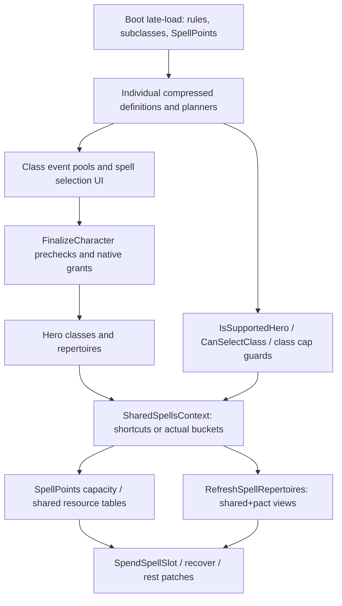
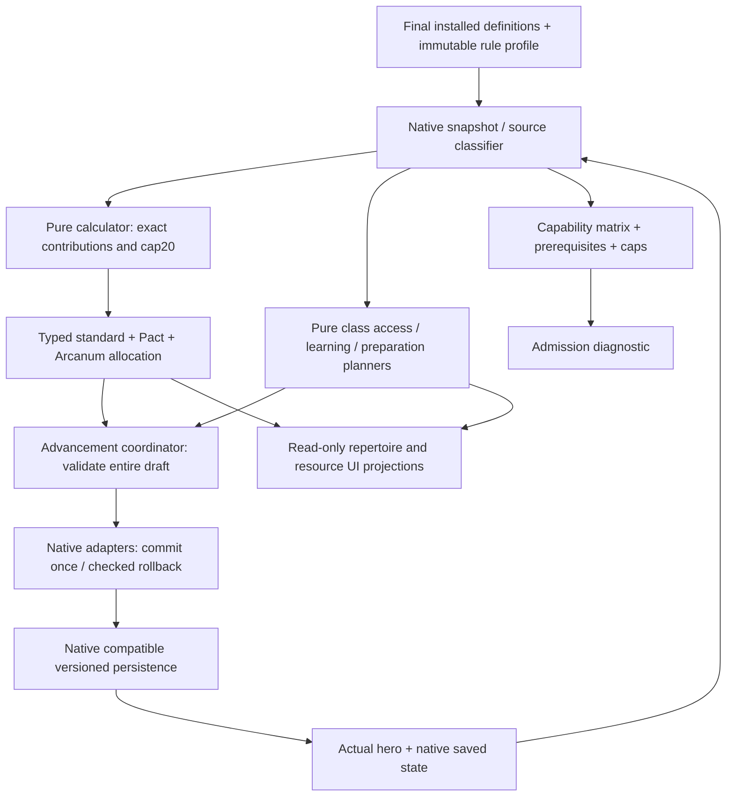

# Stage 13.1 — аудит и план интеграции multicaster

Дата: 2026-11-12. Репозиторий `rork2025-beep/SolastaUnfinishedBusiness`, ветка `feature/progression-20-to-12`. Аудируемый runtime: **cdbe3e84aa3e64cfbd99606c11f06c504d8c7d58** (Stage12).

**Результат этого этапа — проект реализации, не включённая поддержка mixed casting.** Runtime, определения классов, настройки и существующие guards не изменены. Следующие этапы ниже являются предложенной последовательностью работ; их выполнение и снятие ограничений в Stage13.1 не производятся.

## 1. Проверенный baseline и границы доказательств

Повторно выполнено в существующем checkout `/workspace/SolastaUnfinishedBusiness`:

```bash
export PATH="/workspace/.dotnet:$PATH"
export DOTNET_ROOT=/workspace/.dotnet DOTNET_CLI_HOME=/workspace/.setup-solasta/dotnet-home
export NUGET_PACKAGES=/workspace/.setup-solasta/nuget DOTNET_CLI_TELEMETRY_OPTOUT=1
export SolastaInstallDir=/workspace/SolastaUnfinishedBusiness/SolastaFiles
dotnet --list-sdks
dotnet build SolastaUnfinishedBusiness.sln --no-restore -c "Release Workflow" -m:2
dotnet run --project Tests/FighterProgression/FighterProgression.Tests.csproj
git diff --check
```

Фактически: **SDK9.0.320; 6209 checks passed; Build succeeded, 0 warnings, 0 errors**. Заявленные Stage12 цифры подтверждены. Исходных failures нет. Переустановка зависимостей не потребовалась. Исходное состояние tracked files чистое; неотслеживаемая `SolastaFiles/Mods/` уже существовала и содержит локальные build artifacts.

6209 — существующие автономные проверки production planners/transactions на managed doubles и проверки blueprint/Cecil/source metadata. Это не 6209 игровых сценариев. Дополнительно прочитаны IL/metadata установленного `Assembly-CSharp.dll` через Cecil для Mystic Arcanum и rest/cast/serialization путей; DLL не исполнялась и в Git не добавлялась. Ни новый калькулятор, ни предлагаемые acceptance tests ниже на этом этапе не реализованы. Игра, Harmony hooks, GUI, save/load, инвентарь и бой не запускались.

## 2. Карта фактических production-путей

Пути в таблицах указаны относительно `SolastaUnfinishedBusiness/`, если не оговорено иное. Имена относятся к аудируемому commit, а не к предполагаемым tabletop правилам.

| Файл | Ключевые методы/типы | Фактическое назначение |
|---|---|---|
| `Models/BootContext.cs` | `LateLoad` | Сначала Multiclass/Spells/SharedSpells, затем 2014/2024, Subclasses, Inventor SSI, SpellPoints; затем Fighter→…→Inventor progression contexts. GUI recache выполняется после них |
| `Models/SharedSpellsContext.cs` | `ClassCasterType`, `SubclassCasterType`, `GetCasterTypeForClassOrSubclass` | Registry стандартных Full/Half/HalfRoundUp и четырёх OneThird subclasses; Warlock не входит в стандартный registry |
| тот же | `IsMulticaster` | Считает **репертуары** с origin != Race, а не уникальные классы. Monster не исключён этим конкретным предикатом |
| тот же | `GetSharedCasterLevel`, `CasterLevelContext.IncrementCasterLevel/GetCasterLevel` | Short-circuit single compressed casters; иначе суммирование **реальных** уровней по caster-type buckets. Сам accumulator не ограничивает результат20 |
| тот же | `GetSharedSpellLevel`, `LateLoad`, `MaxSpellLevelOfSpellCastingLevel`, `SharedSpellsTranspiler` | Resource ceiling по таблицам1–20; временный флаг обхода getter patch для получения class-local ceiling. Флаг статический, без try/finally |
| тот же | `GetWarlockCasterLevel/GetWarlockSpellLevel/GetWarlockMaxSlots/GetWarlockUsedSlots/GetWarlockSpellRepertoire`, `FactorMysticArcanum` | Независимые Pact capacity/circle и sentinel `PactMagicSlotsTab=-1`; отдельная поправка видимости Arcanum |
| `Builders/Features/FeatureDefinitionCastSpellBuilder.cs` | `EnumerateSlotsPerLevel`, `SlotsByCasterLevel`, `CasterProgression` | Исходные resource tables, включая solo Half/OneThird округление и `forceOnes` для SP |
| `Models/SpellPointsContext.cs` | `LateLoad`, `SwitchFeatureDefinitionCastSpellSlots`, `FeatureDefinitionCastSpellTab` | Подменяет class/subclass slot rows; Warlock исключён из списка замен. При start-at1 у Paladin/Ranger выбираются HalfRoundUp rows |
| тот же | `ModifyPowerPoolAmountPowerSpellPoints.GetCasterLevel/PoolChangeAmount`, `SpellPointsByLevel` | Размер PowerSpellPoints, индексы0–20; compressed single overrides, mixed SharedSpells fallback, затем character-level-based single fallback |
| тот же | `PowerSpellPoints`, `GrantPowerSpellPoints`, `IsSpellPointsEnabled`, `GetMaxSpellPoints/GetRemainingSpellPoints/AddSpellPoints` | Один power pool героя, LongRest; grant хранится под ActiveFeatures[TagRace], что **не делает его расовым casting repertoire**; AddSpellPoints ограничивает максимум |
| тот же | `ConsumeSlotsAtLevelsPointsCannotCastAnymore`, `ConvertAdditionalSlotsIntoSpellPointsBeforeRefreshSpellRepertoire` | Расход SP и slot-view flags; условные дополнительные ячейки конвертируются в SP с удалением condition. В conversion используется прямое `remainingUses +=`, в отличие от capped AddSpellPoints |
| `Patches/RulesetCharacterPatcher.cs` | `RefreshSpellRepertoires_Patch.Prefix/Postfix` | Конвертация condition slots; сбор additional affinities; смешанные shared+pact capacities копируются в Class/Subclass repertoires |
| `Patches/RulesetSpellRepertoirePatcher.cs` | `SpendSpellSlot_Patch.SpendSpellSlot/SpendMulticasterWarlockSlots/SpendWarlockSlots/ConsumeSlot` | Race/Monster расходуются отдельно; стандартные mixed counters зеркалируются; SP списываются один раз через флаг consume; Pact selection зависит от repertoire, Shift и AlwaysSpendPactSlotsFirst |
| тот же | `MaxSpellLevelOfSpellCastingLevel_Getter_Patch`, `CanUpcastSpell_Patch`, `GetLowestAvailableSlotLevel_Patch` | Подменяет resource ceiling на max(shared,pact); это не допустимый уровень изучения каждого класса |
| тот же | `RecoverMissingSlots_Patch`, `HasMissingSpellSlots_Patch` | Recovery распространяет dictionary по репертуарам; predicate missing slots учитывает потраченные SP |
| `Patches/RulesetCharacterPatcher.cs` | `RecoverMissingSlots_Patch.Prefix`, `ApplyRest_Patch.Transpiler/RestoreAllSpellSlots` | В recovery добавляет SP; rest adapter отдельно восстанавливает Pact-составляющую при mixed short rest, full restore на long rest |
| `Patches/SlotRecoveryModalPatcher.cs` | `ShowSlotRecovery_Patch.Prefix`, `Refresh_Patch.BindX` | SP recovery UI сводится к выбору level1 и стоимости; не отдельный универсальный recovery engine |
| `CustomUI/MulticlassGameUi.cs` | `RebuildSlotsTable`, `PaintPactSlots`, `PaintPactSlotsAlternate`, `AddAvailableSubLevels` | Отображение merged resources и выбора круга/pact; источник ресурса частично выводится из контекста |
| тот же | `SpellsByLevelGroupBindLearning`, `GetCurrentPool`, `FilterMulticlassBleeding`, `CollectAllAutoPreparedSpells` | Переключение между class event pools, extended lists/auto spells; class learning hooks вызываются по очереди |
| `Patches/CharacterReactionItemPatcher.cs` | `GetSelectedSubItem_Patch`, `SetupSpellPoints` | Выбор активного subitem, стоимость SP в реакции; необходимо согласование с выбранным resource owner |
| `Api/Helpers/LevelUpHelper.cs` | `RegisterHero`, `SetSelectedClass/GetSelectedClass`, `GetAllowedSpells/GetAllowedAutoPreparedSpells/GetOtherClassesKnownSpells`, `EnumerateKnownAndAcquiredSpells` | Реальный класс текущего повышения, class-local caches; EnableRelearnSpells/DisplayAllKnownSpellsDuringLevelUp влияют на межклассовые дубли |
| тот же | `GetClassForSubclass`, `GetMaxAutoPrepSpellsLevel`, `GrantCustomFeatures`, `GrantCustomFeaturesFromFeats` | Восстановление owner класса, bonus spells, custom/feat grants; feat может создать repertoire с null class/subclass/race |
| `Api/GameExtensions/RulesetSpellRepertoireExtensions.cs` | `GetCaster`, `GetCastingClass` | Owner через BearerGuid (fallback Global.InspectedHero), ClassHolder и Druid owner resolver. Нельзя полагаться на inspected hero при команде/сериализации |
| `Api/Helpers/MulticlassInOutRulesHelper.cs` | `EnumerateHeroAllowedClassDefinitions`, `ApproveMultiClassInOut`, `MyGetAttribute`, `GetItemsAttributeModifiers` | Проверяет выход из текущего класса, поддерживаемость, MaxAllowedClasses, входные характеристики; затем все compressed cap/caster guards. Учитывает базовые/additive значения с исключением соответствующих предметных прибавок |
| `Patches/RulesetCharacterHeroPatcher.cs` | `CanLevelUp_Getter_Patch`, `AddClassLevel_Patch.Prefix`, `ComputeMaxPreparedSpells_Patch` | Реальный total cap/история; независимая граница class selection; 2024 preparation tables |
| `Patches/CharacterBuildingManagerPatcher.cs` | `AssignClassLevel_Patch.Prefix`, `FinalizeCharacter_Patch.Prefix/Postfix`, `TrainInvocation_Patch`, `UnlearnInvocation_Patch` | Повторный cap/caster guard; последовательная prevalidation; затем native/custom mutation; custom invocations обходят native Warlock point-pool accounting |
| `Models/ToolsContext.cs` | `FunctorRespec.Execute`, активный `FinalizeRespec`, `TransferConditionsOfCategory`, `CleanupOldHeroConditions`, `DropInventoryOnFloor/DropItem` | Новый герой, termination старых effects, GUID swap/condition transfer, inventory handling. Первый вариант FinalizeRespec под `#if false` не является действующим |
| `Patches/RulesetCharacterPatcher.cs` | `SerializeElements_Patch.Postfix`, `SetupFromSubstituteCharacter_Patch` | Deserialization power attribute fix и перенос remainingUses из формы |
| `Patches/RulesetActorPatcher.cs` | `SerializeElements_Patch.Transpiler` | Поддержка custom serialized RulesetCondition types |
| `Patches/GameSerializationManagerPatcher.cs` | `Refresh_Patch`, `RefreshAsync_Patch` | Только SaveByLocation/load-button state; это не готовый serializer multicaster ledger |

### 2.1 Все индивидуальные casting adapters

| Файл | Что уже есть и что нужно сохранить |
|---|---|
| `Models/WizardSpellcastingContext.cs` | `Initialize`, `ConfigureLearning`, `TryGetLearningMaximum`, `LearningBoundaryPatch`, `GrantLearningPatch`, `PreparedPatch`; scribing events, реальные spellbooks/pages/OwnerName. IsSupportedHero/CanSelectClass — более ранний и более узкий registry-based вариант |
| `Models/SorcererSpellcastingContext.cs` | `Initialize`, `Events`, `KnownBefore`, `ConfigureLearning`, `FilterSelection`, Acquire/Unlearn/Undo/Clear/Grant patches, `ValidateLearningPatch`, `SingleCasterLevel`; отдельные learning/replacement события |
| `Models/WarlockSpellcastingContext.cs` | Те же известные/заменяемые spells и UI events, но `PactSpellLevel` максимум5; Initialize проверяет ShortRest и native Pact rows. `ValidateLearningPatch` вызывает также `WarlockInvocationContext.CanAccept` |
| `Models/BardSpellcastingContext.cs` | `Initialize`, `Events`, `ConfigureLearning`, Collect/Build steps, Acquire/Unlearn/Clear/Grant и IsSupportedHero/CanSelectClass; вместе с partial-файлом ниже |
| `Models/BardMagicalSecretsContext.cs` | partial **BardSpellcastingContext**: `RegisterSecrets/RegisterSecretTag`, `Choices`, `Initial/Apply/Before`, `Allowed/InClassLists`, `ValidateAll`, `BeginFinalize`. Secrets хранятся отдельно от обычных known spells |
| `Models/ClericSpellcastingContext.cs` | WholeList/Prepared; `Initialize`, `AdaptAutoPrepared`, `PreparedPatch`, `BeginFinalize`, per-level/origin grant ledger; настоящая WIS и 2024 table |
| `Models/DruidSpellcastingContext.cs` | Аналогичный WholeList/Prepared, WIS/circle lists; `BeginFinalize`; связан с `DruidWildshapeContext.SpellPointOwner/IsSupportedWildShape/FormCastingLevelPatch` |
| `Models/PaladinSpellcastingContext.cs` | WholeList/Prepared, `CaptureRules`, `SingleCasterLevel`, `PreparedPatch`, `BeginFinalize`; Half/HalfRoundUp, обычная подготовка CHA+floor(original/2), независимо от resource rounding |
| `Models/RangerSpellcastingContext.cs` | Selection/AllKnown, `Initialize` отвергает внешнюю WholeList замену; захватывает final known/replacement tables и original maximum circles, `ConfigureLearning`, `Events`; 2024 flag не превращает автоматически Ranger в prepared caster |
| `Models/RangerSpellLearningContext.cs` | partial RangerSpellcastingContext: `Allowed`, `Initial/Apply/Before`, `ValidateAll`, `BeginFinalize`; production `RangerSpellLearningState<T>`, порядок исходных learn/replace и legacy invocation validation |
| `Models/InventorSpellcastingContext.cs` | WholeList/Prepared/INT/HalfRoundUp, `Initialize`, `PreparedPatch`, `BeginFinalize`, `SlotsRefreshPatch`; не wizard spellbook и не known-spell кастер |
| `Models/FighterProgressionContext.cs` | Сжатие только Fighter/Champion/WeaponMaster; `LateLoad` удаляет из runtime subclass choice остальные Fighter subclasses, включая third casters |
| `Models/RogueProgressionContext.cs` | Сжимает class/subclass features, но прямо сообщает, что ShadowCaster/ArcaneScoundrel casting tables, shared caster level и SP **не сжаты** |

Cleric/Druid legacy preparation = max(1, own effective level + real WIS + affinity bonuses); Paladin/Inventor = max(1, floor(own effective level/2) + real CHA/INT + bonuses). Wizard добавляет effective−actual к native legacy result. Общая 2024-таблица `ComputeMaxPreparedSpells_Patch` содержит **Cleric, Druid, Paladin, Wizard**, не Inventor/Ranger/Bard/Sorcerer. Значения и affinities необходимо читать из финальных definitions; названия флагов не заменяют эту проверку.

Существующие `IsSupportedHero` обычно требуют одновременно: не IsMulticaster, отсутствие чужого non-Race casting feature, отсутствие второго casting class/subclass. `CanSelectClass` поздних adapters также избегает класса, у которого все доступные subclasses кастующие; Wizard проверяет registry более узко. Есть отдельные AssignSubclass/feat guards. Изменение только одного helper не разрешает безопасный mixed build.

### 2.2 Транзакции и порядок финализации

- `Models/FighterProgressionPlan.cs`: stable original event mapping `[1,2,3,4,5,7,9,11,13,15,17,20]`, `FighterProgressionInitialization` — session latch, включая OFF.
- `Models/SpellcastingProgressionPlan.cs`: `OriginalLevels`, `ProjectRows/ProjectCumulative`, `PrimaryScribedEvents`, `CanFitSpellbooks`. Projected definition уже индексируется **реальным** уровнем: повторно передавать effective в неё нельзя.
- `Models/KnownSpellsProgressionPlan.cs`: `Events`, `Learned`, `CompressedReplacements`, `ApplyEvent`, `OrderSteps`; budget и chronological removals/additions. Один итоговый cumulative total не заменяет отдельные события.
- `Models/BardSpellLearningState.cs`: `LearnOrdinary/LearnSecrets/LearnCantrips`, `Ordered`; отдельные Origins и защита от дублей в пределах Bard. `Models/RangerSpellLearningState.cs`: production immutable Apply с бюджетами и allowed predicate.
- `Models/WarlockInvocationContext.cs` + `Models/WarlockInvocationTransactionsContext.cs`: `Configure`, `Transaction`, `BeforeChange`, `ValidateComplete`, `CanAccept`, `BeginFinalize`, `ApplyOrPass`, `FinalizationPatch.Transpiler/Finalizer`. `Models/WarlockInvocationTransaction.cs`: `Replay/Before/Prepare/ApplyPrepared/InvalidatedBy`. Проверяются original prerequisites, snapshot/rollback, grant-collision и repeated finalization. Некоторые immediate/choice-grant retraining/reacquisition намеренно отклоняются; это не готовый universal hero rollback.
- `Models/InventorInfusionPlan.cs`, `Models/InventorInfusionContext.cs`: отдельные custom Infusion pools/Origins, используют тот же pure transaction journal, но собственный custom UI и фильтры. `TryApply` вызывается из Warlock ApplyOrPass **до** его собственного branch. Нельзя считать все custom invocations Pact Magic.
- Фактический `FinalizeCharacter_Patch.Prefix`: Warlock invocation BeginFinalize → Bard → Cleric → Druid → Paladin → Ranger → Inventor spells/infusions, затем GrantRaceFeatures/feat/custom grants и native finalizer. **Wizard, Sorcerer и Warlock spell learning не имеют здесь аналогичного общего BeginFinalize**: у ранних adapters значительная часть проверки остаётся в acquisition/UI. Для mixed mode нужна единая server-side prevalidation перед любыми grants, даже при обходе UI.

### 2.3 Warlock: установленный механизм

Warlock не Full caster для SharedSpellsContext. Pact circle/capacity рассчитываются из own Warlock actual/effective level; на original20 — четыре слота круга5 с ShortRest recharge. Таблица `SharedSpellsContext.WarlockCastingSlots` — вспомогательное представление Pact capacity на нескольких кругах; это отличается от проверяемой WarlockSpellcastingContext native definition с одним ненулевым кругом. Не складывать каждую ненулевую ячейку вспомогательной строки как отдельный ресурс.

Mystic Arcanum: официальные PointPoolWarlockMysticArcanum6/7/8 на original11/13/15, UB `Level20Context.WarlockLoad` добавляет9 на17; compressed actual8/9/10/11. Это Spell pools с точным min=max circle и ExtraSpellsTag=`MysticArcanum`. Установленная native DLL содержит:

- `RulesetSpellRepertoire.IsMysticArcanumSpell`, `SpendMysticArcanum(int)`, `IsMysticArcanumAvailable(int)`, `RestoreAllMysticArcanum`, `SerializeElements`;
- выборы в `extraSpellsByTag["MysticArcanum"]`, расход в **usedMysticArcanum[circle]**, отдельно от usedSpellsSlots;
- `RulesetCharacter.CastSpell` направляет Arcanum в SpendMysticArcanum вместо обычного SpendSpellSlot;
- `RulesetCharacter.ApplyRest` отдельно вызывает RestoreAllMysticArcanum на LongRest; обычный repertoire.RestoreAllSpellSlots очищает usedSpellsSlots, не этот dictionary.

Это подтверждено чтением IL/metadata, не выполнением боя/rest. Arcanum не даёт вклад в shared caster level, SP, стандартные slots6–9 или Pact circle6–9.

`WarlockProgressionContext.RecoverPactSlots` пока поддерживает только single caster: очищает native positive-circle counter, а не mixed sentinel−1. `SharedSpellsContext.RecoverySlots` различает Wizard Arcane Recovery, Land Natural Recovery, Warlock Eldritch Master и SpellMaster Bonus Recovery. `Level20Context.PowerWarlockEldritchMaster` клонирует recovery power; legacy/2024 параметры должны оставаться source-driven. Просто ослабить IsSupportedHero здесь опасно.

### 2.4 Racial, feat и bonus spell access

Origin enum не является полной схемой владения. `Feats/CasterFeats.cs.MakeSpellFeatureAndInvocations`, некоторые `RaceFeats/OtherFeats` создают **Race-origin** casting features для feat spells; потому не всякий Race-origin repertoire означает биологическую расу. `LevelUpHelper.GrantCustomFeaturesFromFeats` может вызвать GrantSpellRepertoire с null class/subclass/race. `RulesetSpellRepertoirePatcher.FormatTitle` специально обрабатывает такие случаи.

Auto-prepared/extended-list grants, Magical Secrets и invocation extra spells часто добавляются к существующему repertoire и **не создают дополнительного casting class**. Native `ComputeAutopreparedSpells_Patch` проверяет SpellcastingClass либо `RepertoireValidForAutoPreparedFeature`, затем class-local GetSpellcastingLevel. `GetClassForSubclass` ищет top-level subclass choice и требует отдельного внимания при wrapped definitions.

Bard legacy Secrets сохраняют отдельные CantripOrSpell pools и ExtraSpellsByTag; 2024 `Tabletop2024Context.SwitchBardBardMagicalSecrets` расширяет доступ через Cleric/Druid/Wizard lists. `BardMagicalSecretsContext.InClassLists` включает соответствующие affinities с original10. Ни чужой список, ни общая высокая ячейка не меняет Bard learning budget. Общие hero.FeaturesToBrowse affinity sums после допуска нескольких классов необходимо проверить на двойной учёт AdditionalKnown/AdditionalScribed/Prepared bonuses.

## 3. Обнаруженные архитектурные риски

1. **Single/mixed разные пути.** Single compressed shortcuts возвращают собственный caster level только при IsSupportedHero. Mixed guards выключают их; разрешение mixed без нового calculator незаметно вернёт actual levels. Wizard отсутствует среди shortcuts GetSharedCasterLevel, хотя имеет отдельный compressed override в SpellPoints.GetCasterLevel. Его shared UI ceiling и SP budget могут идти разными путями.
2. **Fallback через CharacterLevel.** Некомпрессированный single casting class + martial может получить SP по общему уровню персонажа; например Wizard8/Fighter12 попадает на Full=character20, а не own Wizard8. Это source-level discrepancy, не утверждение об исполненном игровом сценарии. Новая модель должна использовать class-local contribution; OFF остаётся на baseline, исправление только в явно включённом новом режиме.
3. **Rounding сгруппирован.** Legacy mixed округляет суммы типов, не каждый класс. Две нечётные Half или OneThird могут давать другой результат. Warlock создаёт mixed context при нулевом стандартном вкладе.
4. **Raw sum >20.** Сейчас вызовы `FullCastingSlots[S−1]`, `SpellPointsFullCastingSlots[S−1]`, `SpellPointsByLevel[S]` сами не ограничивают S. После сжатия raw31 возможен при actual20; без clamp будет выход за таблицы. Существующие guards предотвращают поддерживаемый доступ к таким compressed mixed сценариям.
5. **Один getter, две задачи.** MaxSpellLevel getter смешивает class access и shared/pact upcast availability; helper со статическим bypass-флагом используется в разных UI/native местах. Ошибка контекста открывает чужие learning circles либо скрывает законный upcast. Нужны разные explicit queries.
6. **Зеркалируемые dictionary не отдельные pools.** Повторный debit/refund/recovery на каждом repertoire удвоит расход/восстановление. Recovery loop сейчас посещает даже больше origins, чем refresh/spend filters; projection должна иметь явный список views.
7. **SP flags неоднозначны.** ConsumeSlots… ставит positive slot flags при нехватке SP и отдельно при cast circle>5. Нельзя из одного usedSpellsSlots после save/load надёжно вывести, это affordability-view или исчерпанное high-circle использование. High-circle ограничения надо сохранять по installed semantics, включая upcast, а не считать Arcanum.
8. **Additional slots неоднородны.** ChitinousBoon affinity — Pact-specific. Temporary condition conversion может поднять remaining SP выше табличного max прямым +=, тогда как AddSpellPoints capped. Не терять bonus resources без явной policy и не переводить постоянную affinity в повторяемые бесплатные SP на каждом Refresh.
9. **Подготовка/affinity bleed.** FeaturesToBrowse scratch-list и некоторые суммы global; class-specific bonuses, list access, duplicate-spell policy и EnableRelearnSpells нельзя объединить в одну глобальную коллекцию known/prepared spells.
10. **Ранние adapters и third casters.** Fighter prototype исключает caster subclasses; Rogue magic оставлена несжатой. Нельзя автоматически назначить OneThird contribution effective20 только потому, что feature progression compressed. Wizard/Sorcerer/Warlock spell finalization требует усиления до снятия guards.
11. **CWT не сохранение.** Selection/grant/action journals временные. Новый расход/версия режима не может жить только в ConditionalWeakTable. Load/clone/shape/respec меняют ссылки и GUID ownership.
12. **Не только spell actions.** Sorcerer conversion, Paladin Smite/recharge, Ranger free Mark, Druid recovery/form и Inventor SSI расходуют связанные ресурсы через разные пути. Native child CastNoCost может наследовать parent UsablePower; повторно списывать parent нельзя.

## 4. Предлагаемая чистая модель

### 4.1 Раздельные величины

| Значение | Определение |
|---|---|
| ActualCharacterLevel | Сумма реальных class levels/ClassesHistory; ≤20, источник HP/PB и соответствующих character-level правил |
| ActualClassLevel | Число реальных уровней конкретного класса; compressed cap12, обычный cap по текущим правилам |
| EffectiveFeatureLevel | M(actual) только для включённого и поддержанного class feature adapter, иначе actual |
| EffectiveCastingLevel | Отдельное значение: M(actual) **только при наличии подтверждённого casting adapter**, иначе actual; не автоматически равно EffectiveFeatureLevel |
| ClassCasterContribution | Точное e/1, e/2 либо e/3 и rounding bucket, плюс eligibility; Pact/auxiliary/None дают0. Не округлять каждый Half отдельно |
| RawSharedCasterLevel | Итог применения выбранного solo/mixed правила к buckets; сохраняется для отчёта и диагностики насыщения |
| SharedCasterLevel | clamp(RawSharedCasterLevel,0,20); используется только для standard resource row/SP base budget |
| ClassSpellAccess | Собственная original-event/class row, list, knowledge/readiness, ability и rule variant; не SharedCasterLevel |
| Learning/Preparation | Независимые class/repertoire/event budgets, cantrips, scribing, prepared table, auto spells, bonus origins |
| StandardResource | Одна authoritative shared slot **либо** SP base allocation, отдельно дополнительные feature credits/slots |
| PactResource | Own Warlock e → source Pact row/circle/short-rest spent; исключён из standard budget |
| OtherResources | Arcanum per-circle, Sorcery Points, Channel Divinity, Wild Shape, free Mark, infusions, stored-item charges и т.п. со своими owners/recharge |

Никакого изменения реального GetClassLevel, истории, HP, PB, INT/WIS/CHA, уровней Summon вне адресного source-owner adapter. Class access должен индексировать либо сохранённые **original** tables по e/event, либо **projected** tables по actual, но никогда projected tables по e.

### 4.2 Округление: установленная семантика и явная policy

Все формулы ниже используют **EffectiveCastingLevel e**, не character total. Для несжатого кастера e=actual. Условие начала колдовства определяется финальным definition/unlock, в том числе start-at1 flags.

| Тип | Установленный solo table/SP path | Установленный grouped multiclass contribution |
|---|---|---|
| Full | e | sum(eFull) |
| Half | 0 до открытия spellcasting; затем ceil(e/2), не tabletop floor | floor(sum(eHalf)/2) |
| HalfRoundUp | ceil(e/2), доступен с1 | ceil(sum(eHalfRoundUp)/2) |
| OneThird | 0 до открытия subclass casting, затем ceil(e/3) | floor(sum(eThird)/3) |
| Pact / None / auxiliary racial-feat | Standard contribution0 | Standard contribution0 |

**Решение:** сохранить оба режима округления, с явным `RoundingMode`. Solo — один уникальный участвующий casting class; mixed — два или три, **включая Pact Warlock в число участников**, хотя вклад Warlock в стандартную сумму0. Иначе Warlock1+Half Paladin3 получит ceil(3/2)=2 вместо установленного mixed floor=1. Racial/feat/bonus views число участников не увеличивают.

Для mixed:

```text
raw = sum(eFull)
    + floor(sum(eHalf)/2)
    + ceil(sum(eHalfRoundUp)/2)
    + floor(sum(eThird)/3)
shared = min(20, max(0, raw))
```

Например Half3+Half3 даёт3, не1+1=2; OneThird4+OneThird5 даёт3, не1+1=2. Buckets Half и HalfRoundUp нельзя объединять: используются разные rounding rules. Registry Paladin/Ranger меняется Switch…SpellCastingAtOne; с flags ON это HalfRoundUp.

Отдельная обнаруженная неоднозначность baseline: accumulator просматривает classes registry даже до фактического открытия их casting, а IsMulticaster смотрит уже существующие repertoires. **Предлагаемая новая policy** допускает contribution/участие только после зарегистрированного casting unlock (class/subclass start): Paladin1/Ranger1 с start-at2 не создают новый ресурс или phantom participant. Это осознанное отличие от отдельных raw-helper edge cases, а не утверждение об их текущем игровом поведении; обязательные golden tests13.2. При OFF такие edge cases не исправлять незаметно.

`CasterProgression.Flat` и фиксированные касты не получают коэффициент Full/Half автоматически: допускаются как auxiliary/innate только после классификации конкретного definition. Неизвестный кастующий источник без registry adapter → `UnsupportedSource` и сохранение guard, не None по умолчанию. Multiple casting features одного owner class не суммируются повторно. Auto-spells/Secrets расширяют доступ, а не вклад.

### 4.3 Сжатые и обычные классы; насыщение

Каждый class snapshot имеет независимые flags feature/casting compression и version/rule fingerprint. Disabled class использует исходный actual уровень, даже рядом с включённым compressed классом. У текущих Rogue third casters eCasting остаётся actual; у compressed Fighter third subclasses вообще недоступны. План не включает неавторизованное добавление сжатой магии этим subclasses.

При raw>20 сохраняем полный trace contributions и выдаём `ResourceTableSaturated`, используем только row20 и SP[20]=133. Не суммируем SP разных классов, не выдаём второй pool133, circle10 или дополнительные epic slots. Class features/learning/preparation не обрезаются до остатка shared budget и не делятся между классами. Cap относится к **табличному базовому ресурсу**; независимо легитимные feature/item bonuses классифицируются отдельно, а не теряются при clamp.

Пример Wizard12 compressed + Cleric8 ordinary: raw20+8=28, shared20, base133 SP; Wizard access9, Cleric access4 и подготовка по Cleric8. Пример Wizard8 compressed + Sorcerer12 compressed: raw11+20=31, shared20; actual total20, собственные access6 и9.

### 4.4 Предлагаемые интерфейсы (спецификация, не готовый код)

```csharp
// Только immutable DTO, IDs и числа. Никаких Unity/Harmony/Main.Settings/ServiceRepository.
public enum ResourceDomain { Standard, Pact, Arcanum, Innate, Item, ClassPower }
public enum RoundingMode { InstalledSolo, UbGroupedMulticlass }
public enum SourceRole { StandardClass, PactClass, AttachedGrant, Innate, Item, Unsupported }

public record ClassCastingInput(
    string ClassId, string SubclassId, string CastingDefinitionId,
    int ActualLevel, int EffectiveFeatureLevel, int EffectiveCastingLevel,
    CasterKind Kind, bool CastingUnlocked, SourceRole Role, string ProfileVersion);
public record ExactContribution(string ClassId, int Numerator, int Denominator, CasterKind Bucket);
public record ContributionBucket(CasterKind Kind, int LevelSum, int RoundedValue);
public record SharedCastingResult(
    int ActualCharacterLevel, RoundingMode Mode,
    IReadOnlyList<ExactContribution> Classes, IReadOnlyList<ContributionBucket> Buckets,
    int RawLevel, int ResourceLevel, bool Saturated, IReadOnlyList<Diagnostic> Diagnostics);

public interface ISharedCasterCalculator {
    SharedCastingResult Calculate(CastingSnapshot input, InstalledResourceTables tables);
}
public interface IClassSpellAccessPlanner {
    ClassSpellAccess Access(CastingSnapshot input, RepertoireKey owner, int originalEvent);
    PreparationPlan Preparation(CastingSnapshot input, RepertoireKey owner);
    IReadOnlyList<LearningEvent> Advancement(CastingSnapshot input, ClassLevelChange change);
}
public interface IResourcePlanner {
    ResourceAllocation Allocate(CastingSnapshot input, SharedCastingResult shared);
    ResourceTransition Spend(ResourceState before, SpendRequest request);
    ResourceTransition Recover(ResourceState before, RecoveryRequest request);
}
public interface IAdvancementPlanner {
    ValidatedAdvancement Prepare(CastingSnapshot before, AdvancementDraft draft);
}
```

`CasterKind`, Snapshot, tables, requests и diagnostics должны быть определены как DTO в13.2. Native adapter лишь снимает source/rule snapshot, классифицирует feature origins и передаёт immutable данные. Предлагаемое имя opt-in настройки — `EnableCompressedMulticasterPrototype` (OFF по умолчанию); в Stage13.1 такое поле не добавлено. Новый resource engine применяется только при этом флаге, валидном profile marker и подтверждённой capability; OFF всегда сохраняет старый путь. Admission читает capability matrix, а не вызывает старый SingleCasterLevel. Calculator не вызывает IsSupportedHero (иначе mixed станет0 либо возникнет цикл). `UnsupportedSource`, `AmbiguousOwner`, `IncompatibleProfile`, `IncompleteEvent`, `ResourceExhausted`, `ClassCapDeadlock` — структурированные результаты, не пустые списки без объяснения.

Resource tables передаются из финального installed registry, включая slot zero/sentinel conventions, own-class access rows, SP costs `[0,2,3,5,6,7,9,10,11,13]`, SP base0…133 и Pact rows. Input validation отвергает невалидные actual levels/history/caps; clamp применяется к resource total, не маскирует Inventor13 или повреждённый snapshot.

## 5. Владение ресурсами и сохранением

`HeroId` — native GUID. `RepertoireKey` включает casting-definition ID, class/subclass/racial/feat source и native repertoire identity; отдельный `GrantOriginId` хранит исходный event/pool. Несколько grants могут принадлежать одному repertoire: не создавать второй repertoire ради нового origin. Contribution dedup — по casting owner class, не по количеству features или native views.

| Ресурс/состояние | Authoritative owner | Представление / правила |
|---|---|---|
| Shared slots | Hero + Standard + profile | Один spent counter по circle; native Class/Subclass capacities/used dictionaries — только согласованные views |
| Shared SP | Hero.PowerSpellPoints + profile | Один base remaining/debit; affordability flags производные; high-circle use flags отдельны. Родительское действие и child spell не платят дважды |
| Feature additional slots/SP | Grant/effect GUID + domain | ChitinousBoon → Pact; другие grants по подтверждённой source policy. Temporary conversion idempotent по condition/grant token; normal capped recovery отдельно от допустимого bonus credit |
| Pact | Hero + Warlock casting ID | Own circle/capacity и short-rest spent. Native−1 и positive views — проекции, не несколько budgets |
| Mystic Arcanum | Warlock repertoire + circle/grant | ExtraSpellsByTag + usedMysticArcanum. LongRest, не SP recovery и не Pact refill |
| Known/cantrips/prepared/auto spells | RepertoireKey + GrantOriginId | Никакого глобального union, который теряет способность, список, ownership или право замены |
| Wizard book | Native book item GUID + OwnerName + Wizard repertoire | Native страниц/доступных книг и costs. Не переписывать владельца, не создавать книгу/скроллы в calculator |
| Secrets / invocation grants | Bard/Warlock repertoire + original origin | Могут обращаться к чужим lists; resource contribution не создают |
| Sorcery/Channel/WildShape/free Mark/infusions/SSI | Их существующий class/power/item owner | Не нормализуются в shared casting level; расходы/конверсия идут через typed ResourceTransition |

Slot mode и SP mode выбирают единственное primary standard representation. На refresh не суммировать capacity каждого класса и не восстанавливать spent. При изменении max в level-up нужна явная политика сохранения потраченного количества; сначала зафиксировать native baseline, затем тестировать переход, а не выдавать полный refill каждым Refresh. Resource transition должен иметь ActionId/RestId, expected version, выбранные Domain/Owner/Circle и отдельные validate/commit, обеспечивающие ровно один расход/возврат на действие.

Pact/spell source независимы: spell, известный Wizard, может пользоваться допустимым Pact resource согласно installed UB selection policy. Это не делает его Warlock known spell и не меняет INT на CHA. Arcanum, racial free cast, invocation free cast, free Mark и stored-item activation должны проходить по своему явному domain до standard debit; `SpendRequest` не должен угадывать domain только по spell circle или non-null inherited UsablePower.

Для versioned resource state недостаточно CWT. Native сериализует repertoire usedSpellsSlots/usedMysticArcanum и usable powers, но неоднозначные SP flags и profile fingerprint требуют подтверждённого carrier. Кандидат — существующий pattern custom serialized RulesetCondition (`RulesetActorPatcher.SerializeElements_Patch`, пример `Subclasses/Builders/EldritchVersatility.cs.SerializeElements`); Stage13.7 обязан проверить lifecycle/round-trip и возможность прочитать неизвестную версию. Это **ещё не выбранная и не реализованная новая схема save**. При отсутствии безопасного carrier admission остаётся закрытым. Не добавлять непроверенные поля в native serializer и не объявлять GameSerializationManagerPatcher готовым решением.

Только новые тестовые mixed heroes/saves, полный restart при profile change. Не мигрировать старые saves автоматически и не восстанавливать ambiguous counters по эвристике. Load с несовпадающей версией/режимом или противоречивыми mirror dictionaries → diagnostic/refusal до расхода/level-up; не молчаливый refill. Druid form использует owner hero pool и rebinding после load, не второй state; исправить также monster branch SpellPoints.PoolChangeAmount, который сейчас берёт только Druid.SingleCasterLevel.

## 6. Граф зависимостей и точки интеграции

Текущий путь:



Предлагаемое направление зависимости (без цикла calculator↔admission):



Конкретные будущие изменения:

1. Snapshot registry после финальных source switches, но **до** destructive compression projection: конкретная точка Boot — после SpellPointsContext.LateLoad, перед FighterProgressionContext.LateLoad. Альтернатива — хранить original rows в каждом class adapter при Initialize. Второй проход ProjectRows по уже compressed rows недопустим. Resource baseline tables остаются uncompressed; class access может использовать original snapshot или actual-index projected rows.
2. GetSharedCasterLevel и private SpellPoints.GetCasterLevel должны делегировать одному результату calculator **только для разрешённого нового режима**. Legacy OFF paths не менять. Все table-index потребители получают bounded result, в том числе reaction/upcast UI.
3. RefreshSpellRepertoires строит domain-specific views из owner ledger. Spend/Recover/ApplyRest обрабатывают typed domain ровно один раз; native positive/−1 encoding не становится источником истины для двух бюджетов. Проверить дополнительные consumers в `SorcererProgressionContext` conversion, `PaladinPowerSafetyContext`, `2024DruidContext`, `RangerMarkContext`, `InventorItemSafetyContext`, SlotRecoveryModal и CharacterReactionItem.
4. Shared resource ceiling отделить от class access query в learning, HasKnowledgeOfSpell, EnumerateUsableSpells, ritual UI, ItemMenuModal, campaigns inspection. Последние consumers зарегистрированы SharedSpellsTranspiler: глобальная замена этого getter без audit каждого call site запрещена.
5. Class event UI получает явный RepertoireKey+EventId. Порядок `(owner, actual change, original, phase, stable origin)`; внутри продвигаемого класса chronological events, ordinary learning/secrets/invocation child pools не смешиваются. Остальные class panels — read-only, пока их class level не меняется. Race/feat events обрабатываются своим owner.
6. Единый coordinator вызывает validation **всех затронутых owners**, включая pending feat/subclass/granted repertoires, до GrantRaceFeatures/GrantCustomFeatures/native finalizer. Изолированные guards не должны независимо получить взаимоисключающие решения. Wizard book capacity и ownership проверяются и в finalization, не только в GUI.
7. `Prepare` строит immutable draft/snapshots до mutation; `Commit` применяет original events один раз. Warlock/Infusion journals остаются отдельными adapters. На сбое rollback только явно охваченной поверхности; если native grants/inventory нельзя откатить, операция запрещается заранее либо помечается poisoned с Cancel/reload. Не обещать общий inventory rollback.
8. Последним шагом заменить только mixed-caster rejection на capability-aware admission в EnumerateHeroAllowedClassDefinitions, AssignClassLevel, AddClassLevel, BeginLevelUp, AssignSubclass/feat guards, individual IsSupportedHero/action safety/finalizers. Class caps, total20, MaxAllowedClasses=3, реальные prerequisites, session/restart, старые-save guards и item/companion guards сохраняются.

## 7. Матрица совместимости и численные примеры

Это **целевая матрица**, не текущая поддержка. Сегодня mixed с compressed caster блокируется. `C` — подтверждённый compressed casting adapter; `N` — обычный actual casting; `H` — Half/start-at2, `HU` — HalfRoundUp/start-at1. Examples предполагают допустимые характеристики/классы и total≤20.

| Комбинация | Пример / ожидаемый расчёт нового режима | Классовые ограничения и условие допуска |
|---|---|---|
| Full C + Full C | Wizard12+Sorcerer8: e20+11=raw31 →20, 133 base SP | Own access9/6; один shared pool, два learning owners |
| Full C + Full N | Wizard12+Cleric8:20+8→20 | Cleric access4/prepare8, не effective11; не пересжимать обычный класс |
| Full N + Full N | Wizard5+Cleric5:raw10,64 SP | Обычные class access3/3, если новый режим явно включён; OFF baseline unchanged |
| Full + Half H | Wizard6 C+Paladin6 C:7+floor(7/2)=10,64 SP | Own circles4/2; общая ячейка5 только для допустимого upcast |
| Full + HU | Wizard6 C+Inventor6 C:7+ceil(7/2)=11,73 SP | Own circles4/2; реальный INT/preparation Inventor сохранён |
| Half H + Half H | Paladin6 C+Ranger6 C:floor((7+7)/2)=7,38 SP | Оба имеют own circle2; не учить circle4 из общего бюджета |
| Half/HU + Half/HU | Half3+Half3 →3; Half3+HU3 →1+2=3; HU3+HU3 →ceil(6/2)=3 | Тестировать все flags и нечётные buckets, не round по каждому классу |
| Warlock C + Full C | Warlock12+Wizard8: Pact e20=4×circle5; standard e11=73 SP | Arcanum6–9 отдельно; Wizard own access6; Shift/preference не меняет spell ability |
| Warlock + Half H | Warlock1 N+Paladin3 N: standard floor(3/2)=1,4 SP + Pact1×circle1 | Mixed rounding, несмотря на один standard class. Paladin может иметь own circle1 |
| Warlock + HU | Warlock12 C+Inventor8 C: standard ceil(11/2)=6,32 SP + Pact4×5 | Inventor own circle3; infusions/SSI отдельно |
| Full + OneThird N | Wizard6 C+Spellblade6 N:7+floor(6/3)=9,57 SP | Fighter compression OFF; собственная third-caster магия actual6 |
| OneThird N + OneThird N | Spellblade4+ShadowCaster5:floor(9/3)=3,14 SP | Собственные доступ/known/preparation не берутся из shared3 |
| Rogue feature C + OneThird | Rogue8 C ShadowCaster: eFeature11, eCasting8 | Никакого автоматического eCasting11/20; отдельная проверка existing magic adapter |
| Fighter feature C + caster subclass | Spellblade/SpellShield | **Остаётся недоступно**: текущий Fighter prototype допускает только Champion/WeaponMaster; план не снимает этот guard |
| Три casting classes | Wizard8 C+Cleric6 C+Sorcerer6 C:11+7+7=25→20 | Три независимых spell owners/abilities, один standard budget133 |
| Full + Half + Pact | Wizard6 C+Paladin6 C H+Warlock8 C:raw7+3=10 | Pact e11=3×5 отдельно; actual total20, third class cap сохранён |
| Один caster + martial | Wizard8 N+Fighter12 N:new-mode own caster8,44 SP | Не current fallback character20/133; explicit opt-in correction, OFF не меняется |
| Class + racial/feat spells | Wizard + native Race-origin Magic Initiate/innate casts | Вклад0, не меняет rounding mode; native free uses/ability/list и rest отдельно |
| Subclass auto-spells / Secrets | Cleric domain, Inventor Innovation, Bard Secrets | Attached grants, не второй caster; правильный owner/list/original event |
| Неизвестный Class/Subclass/feat repertoire | Origin без registry/ownership proof | Admission закрыт с UnsupportedSource/AmbiguousOwner до adapter, не молчаливый подсчёт |

Все примеры — acceptance expectations выбранной policy, а не исполненные mixed-game тесты.

## 8. План Stages 13.2–13.8 и обязательная приёмка

Каждый этап сохраняет runtime mixed guards закрытыми, пока capability не подтверждена последним rollout-этапом. Можно использовать shadow/read-only diagnostic adapters, но не включать частично готовую комбинацию для игрока. Production pure tests отделяются от Cecil binding checks и Unity tests.

### 13.2 — source registry, immutable snapshot и pure calculator

Deliverables: DTO/interface contracts из§4, profile/version snapshot, dedup classifier, exact contribution trace, solo/mixed rounding, bounded tables. Никаких мутаций героя или нового допуска классов.

Acceptance:

- **M02-01:** все20 original/12 actual mapping; отдельно feature/casting compressed flags, disabled/unsupported level13; actual history/HP/PB/abilities не меняются.
- **M02-02:** Full1…20; Half2/3/7, HU1/3/7, Third3/4/7 solo; legacy bucket mixed rules, odd Half3+3=3 и Third4+5=3; порядок classes/repertoires не влияет.
- **M02-03:** Warlock1+Half3 standard1, Warlock1+HU3 standard2; Warlock alone standard0; racial/feat extra views не переводят solo в mixed.
- **M02-04:** start-at2 Paladin1/Ranger1 не участник до unlock; старт1 switches переводят в HU; class/subclass будущий casting и unknown source дают разные explicit результаты.
- **M02-05:** несколько auto-spells/features одного класса не увеличивают contribution. Class origin с null owner не угадывается по выбранному UI герою.
- **M02-06:** raw20/21/25/28/31 → bounded20, base133; raw0 не обращается к row−1, raw>20 — не к row21; четыре класса/actual total21 отвергаются до расчёта.
- **M02-07:** полный набор примеров§7 как golden tests; входные immutable snapshots/tables не изменились. OFF snapshot вызывает тот же legacy path.

### 13.3 — стандартные slots/Spell Points и recovery owner

Deliverables: read-only shadow сравнение GetSharedCasterLevel/SpellPoints private path; standard ResourceState/Transition; native view adapter под закрытым mode gate; explicit additional-grant и high-circle policy.

Acceptance:

- **M03-01:** Full/Full и Full/Half из§7: ровно один base pool; source20 full133, source20 half64; не сумма личных budgets и не character-total fallback.
- **M03-02:** slots/SP обе настройки; spend/refund/cancel/повтор callback из двух views меняют owner один раз, cantrip/free/ritual не списывает pool.
- **M03-03:** recovery двух репертуаров не удваивает AddSpellPoints; short rest не refills standard LongRest pool, long rest делает это один раз, rest simulation не мутирует state.
- **M03-04:** circles6–9/upcast, affordability flags, high-circle exhaustion, повторные refresh и recovery не создают лишних uses; поведение сверить с installed native convention, Arcanum не затрагивать.
- **M03-05:** temporary slot condition conversion один раз по effect token; capped recovery отдельно от допустимого бонуса сверхbase; ChitinousBoon не попадает в standard credits.
- **M03-06:** start-at1 HalfRoundUp с SP не подменяет корректный budget обычными многократными slots; повтор SwitchFeatureDefinitionCastSpellSlots не пересжимает rows и не refills resource.
- **M03-07:** Druid form→hero→form использует тот же authoritative standard pool, включая mixed capacity; native binding и реальный rest требуют Unity проверки перед admission.

### 13.4 — class access, известные/подготовленные spells и Wizard books

Deliverables: class-local access/preparation/learning planner adapters для всех девяти casting contexts; явный per-repertoire affinity/duplicate policy; Wizard finalization validation. Guards ещё закрыты.

Acceptance:

- **M04-01:** Wizard6 C+Paladin6 C H shared circle5, но Wizard orig6/7 choices ограничены circle3/4, Paladin own circle2; нет shared-circle learning leak.
- **M04-02:** multiclass advancement изменяет только продвигаемый class event inventory, остальные known/cantrips/prepared/auto-spells/abilities сохраняются.
- **M04-03:** known/replacement sequence6/7 и18/19/20, замена раннего same-advancement выбора, Skip/Back/Cancel/Reset; без дублей/бесплатной замены, исходные origins не объединяются.
- **M04-04:** одинаковое spell definition в разных законных источниках не теряет owner. EnableRelearnSpells и DisplayAllKnownSpellsDuringLevelUp ON/OFF проверены; ранний global known filter не уничтожает законный class-local бюджет.
- **M04-05:** Cleric/Druid WIS, Wizard INT, Paladin CHA и Inventor INT: legacy и actual installed2024 tables по собственному уровню, affinity bonus применяется к правильным owners. Ranger остаётся Selection/AllKnown.
- **M04-06:** Wizard книги разных OwnerName/страниц, несколько books, недостаток страниц, initial equipment exception; перед native finalization повторная проверка fitting/ownership и явный отказ без создания книг/потери страниц.
- **M04-07:** ordinary некомпрессированный casting рядом с compressed использует actual rows; auto-spells domain/circle/oath/Innovation и prepared rituals не bleed в другой repertoire.

### 13.5 — Bard Secrets, third-caster adapters и auxiliary grants

Deliverables: совместимость Secrets с class-local learning; разрешённая **обычная** third-caster магия/несжатая Rogue magic; registry adapters для конкретных racial/feat/fighting-style/invocation grants. Не добавлять сжатие third-caster spell progression и не открывать неподдержанные Fighter subclasses.

Acceptance:

- **M05-01:** ordinary Bard известные отдельно от legacy Secrets; Lore/другие реальные secret pools, original10/14/18 →actual8/10/12 и соответствующие subclass события; полный count и независимые origins.
- **M05-02:** 2024 extended Cleric/Druid/Wizard lists начинают действовать на original10, остаются Bard casting, не получают второй repertoire/contribution или чужую preparation ability.
- **M05-03:** Secrets и обычная replacement в одном advancement не отменяют награды друг друга; same-definition policy, Back/Cancel, финальная проверка коллекций и ExtraSpellsByTag.
- **M05-04:** четыре зарегистрированных OneThird subclasses в ordinary mode; mixed floor buckets и solo ceil, максимум/known по их source tables. Rogue feature compression не повышает eCasting; compressed Fighter caster selection остаётся запрещённым.
- **M05-05:** native Race-origin feats, null-owner Class feats, Blessed/Druidic Warrior и Tome-like auxiliary features: каждая зарегистрирована явно; законные innate/free uses и собственная ability, без нового shared contribution/ложного multicaster.
- **M05-06:** unfamiliar grant fail-closed, без пустого level-up; pending feat casting распознаётся до GrantCustomFeaturesFromFeats, не после мутации героя.

### 13.6 — независимые Pact Magic, Arcanum и конверсии

Deliverables: typed Pact owner/views, explicit resource-source selection и домены Arcanum/recovery/conversion; сохраняются invocation transactions и их conservative restrictions.

Acceptance:

- **M06-01:** Warlock12 C+Wizard8 C: standard73 SP + Pact4×5 + отдельные Arcanum6/7/8/9; Warlock12+Inventor8:standard32 SP, не133/не extra Pact pool.
- **M06-02:** выбор Pact/standard через normal action/реакцию/upcast/Shift/AlwaysSpendPactSlotsFirst, включая exhaustion/fallback. Exactly-once debit, собственная spellcasting ability неизменна. Warlock alone с нулём standard SP сохраняет доступные Pact uses и правильную подпись UI, не ложный отказ из-за0 SP.
- **M06-03:** ShortRest/Eldritch Master восстанавливает Pact, не standard SP/Arcanum; LongRest — по доменам; обычный Arcane/Natural Recovery не refills Pact или Arcanum бесплатно.
- **M06-04:** Arcanum exact circles и usedMysticArcanum, CastSpell native branch; не требует standard slot6–9 и не списывает SP, не заменяет обычный known budget; repeated cast/Cancel/rest/save/load отдельно.
- **M06-05:** Invocation choice pools/known-spell prerequisites на original18/19/20, Pact/Tome 2024 и custom Eldritch Surge; нет коллизии с Inventor Infusion transaction. Existing immediate-grant/reacquisition guards остаются до доказанного rollback.
- **M06-06:** Sorcery↔slot/SP conversion, Smite, slot-recharge powers, free Hunter's Mark, Druid recovery, SSI/item charges: выбранный исходный domain тратится/возвращается один раз. Тестировать нативную политику Pact conversion, не предполагать запрет/разрешение из tabletop.

### 13.7 — общий UI/finalization coordinator, respec и persistence

Deliverables: class/event ownership UI, единая Prepare→Commit граница, versioned resource-state carrier после serialization spike, owner rebinding и conservative respec guards. До полного round-trip admission закрыт.

Acceptance:

- **M07-01:** pending class/subclass/feat/race/invocation/Secrets events проходят все validations до native grants; прямой вызов finalize с неполным Wizard/Sorcerer/Warlock draft отвергается так же, как UI.
- **M07-02:** repeated Init/CollectTags/BuildSteps/Finalize не дублируют события/пулы. Cancel/Back/Reset invalidates dependent originals; grant ledgers привязаны к фактическому advancement, а не только reusable data object.
- **M07-03:** fault injection на каждом owned mutation step; rollback заявленного surface, отсутствие resource refill; native inventory/immediate grant вне rollback → отказ до mutation либо poisoned Cancel/reload, без повторного commit.
- **M07-04:** versioned serialized state: 0/partially spent/full slots, SP affordability+high-circle flags, Pact sentinel/positive views и Arcanum survive round-trip. CWT очистить перед load; owner восстанавливается из сохранения. Unknown version/ambiguous mirrors отвергаются до cast.
- **M07-05:** Druid transformation/reversion/deserialization, respec GUID swap и смена canonical native view не копируют ресурс. Sources/conditions не указывают на уничтоженного героя.
- **M07-06:** respec и Cancel с known/Secrets/Arcanum/invocations/Spell Points/books/attuned items/infusions/SSI/summons; существующие Druid/Paladin/Ranger/Inventor cleanup guards сохранены. Никакой автоматической миграции или глобального inventory rollback.
- **M07-07:** actual Unity GUI/reaction/rest/save/load evidence отдельно от managed tests/Cecil. Проверить активный ToolsContext.FinalizeRespec, который drops inventory и превращает spellbook contents в scrolls по source коду; не тестировать только неиспользуемый #if false вариант.

### 13.8 — capability admission, opt-in rollout и полный regression gate

Deliverables: opt-in new mixed-mode setting в существующем UI, OFF default, restart/new-test-saves, ограниченная разрешённая matrix; единогласное решение всех selection/action/finalization guards. Только здесь можно открывать конкретные прошедшие комбинации.

Acceptance:

- **M08-01:** вся матрица§7 в разрешённых режимах обоих orders вступления в классы; 2/3 classes, compressed/ordinary ON/OFF per class; unsigned/unsupported комбинации остаются закрыты с причиной.
- **M08-02:** реальные STR/DEX/INT/WIS/CHA prerequisites, выход из текущего класса, class12/total20/max3, HP/PB/history неизменны. На capped классе без законной альтернативы ясный ClassCapDeadlock, не пустой экран/скрытый bypass.
- **M08-03:** OFF сохраняет baseline outputs/guards; смена mode/profile требует restart. Старый mixed/unmarked save не конвертируется автоматически; отсутствующий/несовместимый carrier блокирует допуск.
- **M08-04:** все6209 baseline checks плюс production suites13.2–13.7; отдельно counts behavioral/metadata/native-game. Release Workflow без ошибок, diff check, никаких DLL/settings/saves в commit.
- **M08-05:** отдельные Unity тестовые герои Full/Full, Full/Half, Half/Half, Warlock/Full, Warlock/Half, third и three-class; long/short rest, recovery, реакции, respec, reload после расхода и отмены. Непрошедшая runtime строка не получает capability=true.
- **M08-06:** Ranger Mark/companions/spell learning, Paladin Smite/recharge, Druid Wild Shape/owner pool, Cleric Channel Divinity, Bard Secrets, Warlock transactions, Inventor infusions/SSI/constructs и martial regressions сохранены. Не признавать combat/save success по compilation.

## 9. Критерий готовности и итог Stage13.1

Архитектурный blueprint готов к реализации pure model в13.2. **Mixed runtime сейчас не готов и не включён.** Основные gates: class/repertoire ownership, grouped rounding, cap20 во всех consumers, ровно один ресурсный debit/recovery, class-local spell events, pre-finalization для всех кастеров и доказанный save-state round-trip. Ни один существующий safety guard этим audit commit не ослабляется.

В Stage13.1 изменяется только этот документ. Не создавались worktree, release merge, mod package или новые runtime patches; source/settings/save/game assemblies не менялись. Commit и push документа — только в `feature/progression-20-to-12`.

## 10. Stage13.2 — реализованный pure calculator

Разделы1–9 выше фиксируют аудит и blueprint Stage13.1. Этот раздел описывает последующий Stage13.2; наличие калькулятора **не означает**, что последующие resource/UI/finalization stages выполнены.

Prerequisite проверен: Stage13.1 committed как `8f45931d052d816aa40c33e78c74310426f3b136`; документ прочитан до изменений. Повторный baseline: SDK9.0.320, 6209 checks, Release Workflow0 warnings/0 errors, tracked tree чистое. Противоречий, блокирующих реализацию pure calculator, нет.

### 10.1 API и изоляция

Реализация: `SolastaUnfinishedBusiness/Models/CompressedMulticasterProgressionPlan.cs`.

- `CompressedMulticasterProgressionPlan(registryVersion, profiles)` — reusable immutable registry; `Calculate(Snapshot)` — детерминированный расчёт без native state.
- `ClassProfile`, `SubclassProfile`, `CastingProfile` — идентификаторы definitions, поддержка feature/casting compression, original subclass/casting unlocks, **двадцать original unprojected spell-access rows**. Класс имеет приоритет перед subclass casting, как installed GetCasterTypeForClassOrSubclass. При отсутствии class casting используется выбранный subclass casting.
- `ClassInput` содержит реальный уровень, `CompressionEnabled` конкретного класса и выбранный subclass. Переданный флаг означает выбранный latched mode класса; будущий native adapter обязан брать его из согласованного session/profile snapshot, а не из изменённой посреди сеанса Settings UI.
- `Snapshot` копирует actual character level, классы, фактическую последовательность class history и явно классифицированные auxiliary sources. Сумма/история проверяются, не переписываются.
- `ClassResult` разделяет `ActualClassLevel`, `ActualSubclassLevel`, `EffectiveClassLevel`, `EffectiveSubclassLevel`, `EffectiveCastingLevel`, `SpellAccessLevel`, `MaximumSpellCircle`, точный `ContributionNumerator/ContributionDenominator`. Subclass actual level — уровень владеющего класса, а не количество повышений после выбора subclass.
- `Result` содержит RegistryVersion, исходный immutable snapshot, class results, отдельные `PactProgressions`, auxiliary access, buckets, `RawSharedCasterLevel`, `ResourceTableIndex`, `StandardSlotRowIndex` и diagnostics.

`ResourceTableIndex` — один scalar0…20, пригодный для SP table index. Для slot rows1…20 используется nullable `StandardSlotRowIndex`: при S>0 это S−1, при S=0 **null**, а не−1. Бюджеты SP/slots, recovery/spend и native pools здесь не создаются. Калькулятор возвращает единственный общий standard index, не личный SP pool каждого кастера.

Readiness gate `MixedGameplayReady=false` — compile-time constant. Новый UB setting не нужен для кода, у которого нет runtime callers; существующие Settings/UI/Boot/SharedSpellsContext/SpellPointsContext и все mixed-caster guards не менялись. Class-specific calculators не заменены. Cecil checks проверяют отсутствие Harmony patches, native/Settings/GetClassLevel dependencies и вызовов нового модуля из прежних production paths.

Реестр в этом этапе — чистые входные profiles, **не подключённый автоматический scanner игровых definitions**. Snapshot DTO не сериализует saves и не читает живого героя. Native capture оригинальных tables в точке Boot из§6, proof классификации auxiliary sources и подключение к ресурсам остаются следующими этапами. Интерфейсы spend/recovery/advancement из§4.4 остаются спецификацией; calculator не изображает их готовой реализацией.

### 10.2 Формула и собственный доступ

Используется существующий `FighterProgressionPlan<int>.EffectiveLevel` после проверки допустимых actual levels. Для класса с включённым и поддержанным feature compression `eFeature=M(actual)`, иначе actual. Subclass feature compression определяется отдельно своим profile. Для casting `eCasting=M(actual)` только если включён флаг класса **и** casting profile поддерживает compression; иначе actual. У None eCasting=0.

После final original casting unlock:

```text
solo:   Full=e; Half=ceil(e/2); HalfRoundUp=ceil(e/2); OneThird=ceil(e/3)
mixed:  raw=sum(Full e)+floor(sum(Half e)/2)
           +ceil(sum(HalfRoundUp e)/2)+floor(sum(OneThird e)/3)
S=min(20,max(0,raw))
```

None/Pact/auxiliary sources не добавляют standard levels. Pact является отдельным `CasterKind.Pact`: сохраняет own effective level/circle и учитывается в числе casting participants для выбора mixed rounding. Поэтому Warlock1+Half3 даёт standard1, а Warlock1+HalfRoundUp3 —standard2. Нет таблицы Pact capacity или Arcanum allocation в этом этапе: их будущие planners получают own Warlock progression, а не S.

Требование unlock проверяется до участия в rounding: Half на original1 с unlock2 не создаёт phantom caster; HU с unlock1 участвует сразу. Half3+Half3 даёт3, Third4+Third5 даёт3; разные Half/HU buckets не объединяются. Actual martial levels не добавляют contribution.

Обычный `MaximumSpellCircle` читается только из **собственной исходной строки** profile по `SpellAccessLevel−1`. Общие высокие slots не повышают learning/preparation/access другого класса. Явные bonus/innate/item grants сохраняются отдельно в auxiliary access и не интерпретируются как ordinary class access; Arcanum также не превращает Pact circle5 в circle9. Ни prepared/known budgets, ни spellbooks, ни конкретные spell choices этот calculator не меняет.

### 10.3 Проверенные примеры

C — включён подтверждённый casting compression; N — обычные actual tables. Это результаты production **pure calculator tests**, не разрешённые игровые multiclass builds.

| Actual build | Effective feature/casting progression | raw → S | Independent ordinary repertoire circles |
|---|---|---|---|
| Sorcerer12C / Wizard8C |20 /11 |31→20 |9 /6 |
| Cleric12C / Wizard8C |20 /11 |31→20 |9 /6 |
| Paladin12C Half / Sorcerer8C |20 /11 |21→20 |5 /6 |
| Ranger12C Half / Inventor8C HU |20 /11 |16→16 |5 /3 |
| Bard8C / Cleric6C / Fighter6C Champion |11 /7 /7; Fighter casting0 |18→18 |6 /4 /0 |
| Warlock12C / Sorcerer8C |20 Pact /11 standard |11→11 |5 Pact /6 standard |
| Fighter8N Spellblade / Wizard12C |8 third /20 full |22→20 |2 /9 |
| Wizard12C / Cleric8N |20 /8 |28→20 |9 /4 |
| Wizard6C / Paladin6C Half |7 /7 |10→10 |4 /2, хотя shared resource row10 поддерживает circle5 |
| Rogue8C ShadowCaster или ArcaneScoundrel / Wizard6C |Rogue features11, casting8; Wizard7 |9→9 |2 /4 |
| Warlock12C alone |20 Pact |0→0, slot row null |5 Pact; no standard row |
| Wizard8N / Fighter12N Champion |8 /12; Fighter casting0 |8→8 |4 /0; martial12 не превращает Wizard8 в caster20 |

Сочетание compressed Fighter с Spellblade/SpellShield выдаёт `UnsupportedCompressedSubclass`, сохраняя рамки существующего Fighter prototype. У обычного Fighter оба third-caster profiles поддерживаются калькулятором. Это арифметическая поддержка ordinary subclass, а не снятие runtime guards Wizard/других классов.

Дополнительно выполняется полная матрица независимых ON/OFF class switches для шести заданных двух-/трёхклассовых builds. Например Paladin12/Sorcerer8 даёт raw14/18/17/21 при flags none/Paladin/Sorcerer/both; Bard8/Cleric6/Fighter6 —14/17/15/18 с теми же casting flags независимо от Fighter feature flag.

### 10.4 Валидация и сохранение ограничений

- Actual character total0…20, не более трёх положительных class entries, собственные actual levels0…20, точное соответствие class counts и истории. Повтор одного ClassId отвергается, а не удваивает вклад.
- Compression flag при actual13+ даёт `UnsupportedCompressedLevel` **до** вызова mapping, не скрытый clamp фактического класса. Неизвестный класс, неизвестный/преждевременный subclass и неподдержанный compression получают отдельные diagnostics.
- Отсутствующий subclass до original выбора допустим и не создаёт casting source; отсутствие обязательного выбора после его порога — `MissingSubclass`, без догадки о third-caster type. Это консервативный контракт полного snapshot для calculator, не новая GUI-политика.
- Unknown auxiliary role/ID/circle, отсутствующий attached owner и конфликтующие сведения об одном source ID отвергаются. Одинаковые повторные auxiliary views deduplicate; несколько AutoPrepared/Secrets grants одного владельца не добавляют contribution.
- Невалидный snapshot возвращает `IsValid=false`, diagnostics, resource index0/slot row null и пустой calculated class list. Это не успешный результат с нулевым бюджетом: будущие callers обязаны проверять IsValid.
- Валидная сумма сверх20 возвращает `ResourceTableSaturated` как **warning**, сохраняет весь class progression trace, raw и один S=20. Собственный class spell access не обрезается и не повышается общей таблицей.
- Profiles, tables и collections копируются/защищены read-only views. Повтор Calculate не трансформирует input и не начисляет ресурс. HP/PB/ability values и native hero references вообще не входят в API; class history остаётся неизменной.

### 10.5 Проверки и последующая интеграция

Тесты: `Tests/FighterProgression/CompressedMulticasterTests.cs`; production файл подключён напрямую в существующий `FighterProgression.Tests.csproj`, suite вызывается из Program.cs. Native DLL не загружается для выполнения калькулятора.

Покрыты все caster kinds на actual0…20 либо compressed0…12, source solo rounding и original access, grouped rounding boundaries, Pact-only/Pact+Half, пустые/martial/racial-only snapshots, cap20 saturation, все примеры и переключения, ordinary/feature-compressed third casters, missing subclasses, invalid history/actual caps/owners, входная immutability и repeated calculation. Отдельные Cecil metadata checks сверяют compiled installed Full/SpellPoints table bounds и изоляцию production module; они не являются runtime Harmony validation.

Финальный полный regression: **7076 checks passed**, включая прежние6209 и **867 новых:862 production pure checks +5 compiled-metadata checks**. Release Workflow: **0 warnings /0 errors**, SDK9.0.320, `git diff --check` проходит. Commit/push приводятся в итоговом отчёте Stage13.2. Допуск игры остаётся закрытым; следующим этапом по blueprint является13.3, но этот commit не начинает ресурсную интеграцию.

## 11. Stage13.3 — standard resource engine (implemented behind the closed gate)

Baseline: committed Stage13.1 `8f45931d052d816aa40c33e78c74310426f3b136`, Stage13.2 `7a493cb3b33c5ab833f76eadfbe255c4ef542bf1`; branch `feature/progression-20-to-12`. Повторный baseline: SDK9.0.320, **7076 passed**, Release Workflow **0 warnings /0 errors**. Исходное tracked-дерево чистое; существующий untracked `SolastaFiles/Mods/` — выход сборки, не часть commit.

### 11.1 Реализованная модель

`Models/StandardCasterResourcePlan.cs` использует **результат production calculator13.2**, а не складывает бюджеты классов. Формула ресурса: `S=clamp(raw shared contribution,0,20)`; обычные slots — оригинальная full-caster строка `S−1`, приS=0 нет строки; базовый SP maximum — установленная таблица `[S]`. Каждый класс сохраняет собственный `SpellAccessLevel`/`MaximumSpellCircle` из13.2. Общая высокая ячейка не выдаёт заклинания, known/prepared choices или spellbook другого класса.

| Пример (C — casting compression ON, N — OFF) | raw→S | Базовый SP maximum | Resource circle |
|---|---:|---:|---:|
| Sorcerer12C / Wizard8C |31→20 |133 |9 |
| Cleric12C / Wizard8N |28→20 |133 |9 |
| Sorcerer8C / Paladin12C Half |21→20 |133 |9 |
| Ranger12C Half / Inventor8C HU |16→16 |94 |8 |
| Wizard8C / Rogue12C ShadowCaster (casting uncompressed) |15→15 |94 |8 |
| Bard8C / Cleric6C / Fighter6C Champion |18→18 |114 |9 |
| Ranger12C Half / Fighter8C |10→10 |64 |5 |
| Fighter12C Champion |0→0 |0 |0 |

Во второй строке Wizard8N — обычный Wizard8; его class access остаётся4, несмотря на общий circle9. У Wizard8C class access6. Half/HalfRoundUp/OneThird rounding не изменён относительно§10. Base133 **один раз**, contribution сверх20 не создаёт дополнительный pool или строку21+. Pact participant отклоняется целиком в13.3, включая Warlock-only; отдельный Pact engine остаётся задачей13.6.

`Tables` копирует native rows/costs, `Allocation` — immutable capacities, `Budget` — единственный ledger owner. Его исполняемые переходы:

- `Spend(operationId,circle)` — выбранная ячейка/upcast либо стоимость SP; одинаковый action token из второго repertoire не списывает повторно. Исчерпанный ресурс не уходит в минус. Cantrip0 бесплатен. Бесплатные native casts/rituals/Spell Mastery/Signature Spells сохраняют native путь до вызова spending.
- `Refund(operationId)` — однократная отмена ранее committed расхода в текущей rest epoch; неизвестный/отменённый/старый token не создаёт ресурс. До commitment Back/Cancel не вызывают ledger. Pure rollback проверен; generic GUI/action-cancellation wiring ещё не подключён.
- В slots mode сохраняется native количество (например, caster20 имеет2 slots circle6). В SP mode circle6–9 — один cast каждого круга до long rest, включая upcast. Флаг реального high-circle расхода отделён от affordability; получение очков открывает **неиспользованный** высокий круг, но не сбрасывает использованный.
- `Recover`/`RecoverPoints` — capped recovery с operation receipt; cost table native `[0,2,3,5,6,7,9,10,11,13]`. Recovery не возвращает high-circle permission.
- `Refresh` меняет capacities, сохраняя расход, отсутствующие временно circles и receipts. Не создаёт ledger или pool повторно. Live resource-mode/registry changes отклоняются.
- Short rest не refills ordinary resources; long rest сбрасывает расход и high-circle limits; simulation ничего не меняет. Старые action/condition receipts сохраняются после rest против поздних повторных callbacks.

### 11.2 Модификаторы и владение

Источник модификатора имеет стабильныйID. Две одинаковые view одного source не дают два увеличения; противоречивый source отклоняется. В slots mode AdditionalSlots увеличивают capacity выбранного circle. Отдельные temporary condition instances имеют разные GUID-based capacity IDs, а не общий ID feature definition. При снятии/возвращении предмета расход не обнуляется. В SP mode permanent AdditionalSlots сохраняют доступность resource circle, но не создают постоянные бесплатные очки; fake slot views не являются вторым расходуемым бюджетом. Изменение native SP pool capacity учитывается один раз сверх `BasePointMaximum`, через `GetMaxUsesOfPower`, без рекурсивного добавления полного maximum. Отрицательные capacity modifiers пока консервативно отклоняются.

Temporary AdditionalSlots из conditions в SP mode превращаются в отдельный bonus credit по `condition.Guid + feature.Name + index` и установленной стоимости. Condition удаляется прежним native API только после grant. Повторный refresh/поздний callback этого GUID не начисляет credit снова. Допустим remaining вышеbase maximum; recovery от этого не становится uncapped. Credit тратится раньшеbase и очищается long rest. `MagicAffinityChitinousBoonAdditionalSpellSlot` исключён из standard modifiers/credits; его владельцем остаётся будущий Pact adapter.

`OwnerStore<TActor>` используется production native context и executable fake-actor tests. `DruidWildshapeContext.StandardResourceOwner` признаёт только исходного героя-Druid, native Wild Shape condition и форму из собственного catalog. Обычные summons/companions не получают pool своего владельца. Mixed owner resolution не использует single-caster `IsSupportedHero` для определения владельца, **не меняя** существующие class/action admission guards. При projection form ссылается на тот же существующий hero `RulesetUsablePower`, не новый pool. Несколько `PowerSpellPoints` у самого героя — диагностируемая ошибка, не автоматическая миграция.

### 11.3 Production integration / dependency graph

```text
BootContext: final 2024/subclasses/Inventor SSI → SpellPointsContext.LateLoad
  → StandardMulticasterResourcesContext.CaptureInstalledTables (read-only, idempotent)
  → existing class compression modules

future validated native class snapshot → CompressedMulticasterProgressionPlan.Result
  → Allocation(installed Tables, mode, modifiers) → Budget[original hero]
  → class/subclass repertoire dictionaries + existing PowerSpellPoints view

RulesetCharacter.SpendSpellSlot → scoped native spell-effect GUID
  → existing preservation/Mastery/Signature checks
  → RulesetSpellRepertoire.SpendSpellSlot → one Budget.Spend → all standard views

SharedSpellsContext.GetSharedCasterLevel/GetSharedSpellLevel → closed adapter
SpellPointsContext max/remaining/can-cast/spend/add/builtin pool modifier → closed adapter
RefreshSpellRepertoires prefix/postfix → temporary credits / capacity refresh / projection
RulesetCharacter.RecoverMissingSlots → standard owner recovery + native recovered notification, skip duplicate repertoire recovery
RulesetSpellRepertoire.RecoverMissingSlots → owner recovery for direct standard calls
ApplyRest native RestoreAllSpellSlots replacement → suppress view-owned restoration
ApplyRest postfix → one owner transition, projection (skip simulation)
```

В stage13.3 **`MixedGameplayReady=false`**, `RuntimeEnabled` не имеет Settings/UI switch. Перед доступом к owner native adapter проверяет gate; приOFF выполняются прежние bodies. В существующих guards/`CanSelectClass`/`IsSupportedHero`/`MulticlassInOutRulesHelper` изменений нет. Классы, HP, actual levels/history, PB, learning/preparation и class-specific resources не переписаны; global `GetClassLevel` patch не добавлен. Settings.xml не читается для перезаписи и не меняется.

`BindNewHero` разрешён только level0 при открытом gate; `UpdateProgression` требует calculator result, совпадающий с actual class levels/history/subclasses. **Вызывающих BindNewHero игровых путей пока нет**: автоматический binder/validated native profile registry, finalize/cancel и persistence — предстоящие13.4/13.7/13.8. Неизвестный/старый герой при будущем включении отклоняется, не получает полный новый budget. Изменение resource settings во время bound session требует restart. Поэтому этот engine не включается простым изменением UI setting.

`CompareLegacyResources` — явный read-only diagnostic API при закрытом gate: legacy shared/SP level, proposedS/maximum, число имеющихся native pools и remaining. Не вызывается автоматически, не меняет definitions/hero resources; для запуска с настоящим hero нужен Unity. В stage13.3 исполнялись production pure models и compiled bindings, **не native shadow comparison**.

### 11.4 Остаточные ограничения и последующие этапы

- **13.4:** достоверный immutable native class/subclass access snapshot, class-local prepared/known/learning limits и Wizard ownership; восстановление UI choices не подменять общей resource capacity.
- **13.5:** явно классифицировать feat/racial/item/attached-grant sources и third-caster access. Текущий resource projection меняет только Class/Subclass; Race/Monster native repertoire не списывает standard budget автоматически. Нельзя открывать admission до завершения этой классификации.
- **13.6:** Pact/Arcanum и typed conversions (Smite, sorcery/other power consumers). Прямой standard `SpendSpellSlot` без native spell-effect transaction в bound engine отклоняется диагностикой. Это намеренный fail-closed, не утверждение о готовности всех spell-powered классов.
- **13.7:** creation/finalization binder, native rollback/cancel, persistent operation journal и повторная загрузка. Pure ledger имеет стабильные recovery/rest tokens; native top-level recovery/rest calls сейчас получают отдельный ID на invocation. Перехват owner API предотвращает multiplication по repertoire, но дедупликация повторного **top-level action invocation** требует persistent action identity следующего этапа. Journal сейчас только в памяти. Старые saves/respec не импортируются.
- **13.8:** тесты в Unity, согласование resource refresh/recharge/order, затем admission. Нельзя просто переключить константу: ещё отсутствуют перечисленные binder/access/persistence/conversion adapters. Native negative/нестандартные capacity modifiers и stacking одинаковых affinity от независимых conditions требуют отдельного review.
- Реальные Harmony bindings, cast action order, free/ritual paths, item/temporary effects, Wild Shape, GUI, rest simulation, respec, save/load, networking и native cancellation **не выполнялись**. Поддержка ordinary single-caster приOFF подтверждена existing pure regression и структурой закрытых adapter calls; это не сравнение игровых сессий.

### 11.5 Контрольные игровые проверки перед Stage13.8

Проводить в отдельной будущей test build после выполнения13.4–13.7, на новых героях и отдельных saves. Gate этой версии для этого не открывать.

1. Сначала OFF: обычный и compressed single caster, slots/SP, level-up/Cancel/Back, short/long rests; сравнить ресурс до/после с прежней сборкой.
2. Для примеров§11.1 в обоих modes проверить S, max/remaining, независимый class spell access; caster20+secondcaster имеет ровно133base SP, не266. Martial levels не увеличивают caster budget.
3. Cast/upcast от каждого repertoire: ровно один debit owner, отображение совпадает во всех views; exhaustion запрещает cast. Cantrip/ritual/free Mastery не тратит ресурс.
4. SP circle6–9: по одному use; recovery очков не возвращает использованный high circle; shortage→recovery открывает ещё неиспользованный. Slots mode сохраняет native counts2 на high circles где они есть.
5. Recovery выбранных slots из двух repertoire panels и повтор action callback: одно восстановление; short rest не refills standard pool, long rest восстанавливает один раз, simulation не изменяет ledger/power/slots.
6. Temporary slot condition→SP credit: один grant, снятие condition, refresh/reload/repeated callback без повторного credit. Capacity item снять/надеть: использованные ячейки не возвращаются; explicit point modifier добавляется один раз.
7. Druid form→cast→revert→cast→form: один owner и один `PowerSpellPoints`, общий расход/остаток; rest в форме и refresh не создают clone budget. Несвязанный summon не использует hero pool.
8. Повтор finalize, Back/Cancel после каждого action stage, cancelled reaction, save/load, respec и смена rules: никаких бесплатных casts или implicit conversion. До реализации persistence эти операции для mixed build не поддержаны.

### 11.6 Проверки Stage13.3

Финальный полный regression: **8065 checks passed** =7076 baseline + **989 новых:967 executed production-model behavioral checks +22 compiled-table/binding checks**. Два прежних isolation assertions уточнены: только engine/adapter13.3 может потреблять calculator, admission paths по-прежнему изолированы; gate остаётсяfalse. Прежние class suites, включая Warlock transactions, Bard Secrets, Cleric/Druid/Paladin/Ranger/Inventor, входят в общий прогон.

SDK **9.0.320**. `dotnet build SolastaUnfinishedBusiness.sln --no-restore -c "Release Workflow" -m:2` — **0 warnings /0 errors**. `dotnet run --project Tests/FighterProgression/FighterProgression.Tests.csproj` — **8065 passed**. `git diff --check` проходит. DLL скомпилирована; это не запуск игры. Повторная установка зависимостей не потребовалась.

Изменённые/добавленные файлы (пути от checkout):

- `SolastaUnfinishedBusiness/Models/StandardCasterResourcePlan.cs` — production pure allocation/ledger/owner store.
- `SolastaUnfinishedBusiness/Models/StandardMulticasterResourcesContext.cs` — закрытый native adapter, original table capture и explicit shadow API.
- `SolastaUnfinishedBusiness/Models/BootContext.cs` — capture ordering.
- `SolastaUnfinishedBusiness/Models/DruidWildshapeContext.cs` — отдельный resource-owner resolver.
- `SolastaUnfinishedBusiness/Models/SharedSpellsContext.cs` — gated shared queries.
- `SolastaUnfinishedBusiness/Models/SpellPointsContext.cs` — gated point queries/spending/recovery/base modifier, defensive table copy и audit level query.
- `SolastaUnfinishedBusiness/Patches/RulesetCharacterPatcher.cs` — spell action scope, refresh/rest/recovery integration; прежний void recovery prefix сохранён для Harmony cooperation приOFF.
- `SolastaUnfinishedBusiness/Patches/RulesetSpellRepertoirePatcher.cs` — owner spending/recovery.
- `Tests/FighterProgression/StandardCasterResourceTests.cs` — новое behavioral/metadata покрытие.
- `Tests/FighterProgression/CompressedMulticasterTests.cs` — уточнение isolation assertions.
- `Tests/FighterProgression/FighterProgression.Tests.csproj` — link production pure engine.
- `Tests/FighterProgression/Program.cs` — вызов новой suite.
- `Documentation/MulticasterIntegrationPlan.md` — этот отчёт/ограничения/checklist.

Generated DLLs/game assemblies/settings/saves/temporary logs не включаются в commit. Commit SHA и результат push приводятся в итоговом сообщении (commit не может содержать собственный SHA). Stage13.3 resource engine и закрытые native hooks реализованы; **mixed-caster gameplay пока не готов и не включён**. Игра, Harmony execution, реальный rest/save/load/respec не проверялись. На этом этапе работа остановлена.

## 12. Stage13.4 — независимые standard spell repertoires

### 12.1 Baseline и рамки

Проверены committed stages13.1 `8f45931d05`,13.2 `7a493cb3b3`,13.3 `1b95f5bf08ea923b8de6aecf5b92f61c818b9188`. На `feature/progression-20-to-12` tracked-дерево до работы чистое; прежний untracked `SolastaFiles/Mods/` — выход сборки. Повторный baseline: **8065 checks passed**, SDK9.0.320, Release Workflow **0 errors /0 warnings**. Не нужны reinstall, worktree, release merge или публикация пакета.

Stage13.4 добавляет ownership/access/preparation model и gated native adapters для **восьми standard casting classes**: Wizard, Sorcerer, Bard, Cleric, Druid, Paladin, Ranger, Inventor. `MixedGameplayReady=false` сохраняется; отдельный UI switch не добавлен, `CanSelectClass`, `IsSupportedHero` и multiclass eligibility не ослаблены. Warlock/Pact/Arcanum/invocation implementation не изменён. ПриOFF прежние пути продолжают работать; boot только читает исходные definitions. Неподдержанный source не обрывает обычную загрузку: capture сообщает диагностическую ошибку, mixed admission остаётся закрытым.

### 12.2 Исходные definitions, владельцы и доступ

`Models/MultipleSpellRepertoiresContext.cs::CaptureInstalledDefinitions/CaptureCore` вызываются **после SpellPoints/rule switches и до Fighter/остальных class compression modules**. Снимаются:

- Actual owning class и casting-feature ID; native spellcasting ability, spell-list ID и сами spell IDs/circles.
- Исходные20 rows class access, cumulative known/cantrips, scribing events и optional replacement events. Cantrip retention сохраняет прежнее UB исправление понижающейся таблицы Sorcerer, не удаляя выученные cantrips.
- Реальная `SpellKnowledge`/readiness: Ranger остаётся **Selection/AllKnown**, включая2024 cumulative known tables; Wizard — Spellbook; Cleric/Druid/Paladin/Inventor — WholeList/Prepared. Новая система не создаёт Wizard book для Inventor и не превращает Ranger в prepared caster.
- Copies native2024 preparation tables только для тех классов, которые действительно перечислены установленным UB: Cleric/Druid, Paladin, Wizard. Inventor остаётся INT+half-level, отдельный выдуманный2024 режим не вводится.
- Original class/subclass auto-prepared groups, extended lists, owner-scoped spell/cantrip choice pools, Magical Secrets и scribing/known affinity budgets. Grant data замораживаются **до** изменения source definitions; later queries не читают пересжатые rows повторно.

Источники имеют ID по class/subclass unlock и пути feature graph, а не только имя pool: repeated rewards остаются разными событиями. FeatureSet **Exclusion** сохраняет prerequisites выбранной ветки; `HasAnyFeature` проверяет actual native ownership перед включением таких grants. Нельзя считать все alternative options одновременно полученными. Реальное распознавание активных options после native clone/level-up требует Unity проверки; нет fallback, который специально выдаёт обе ветки.

`Models/MultipleSpellRepertoiresPlan.cs` — pure production model: immutable `Profile`, `Repertoire`, `HeroState`, `Grant`, `Origin`. У каждого class owner собственные ability/list/effective progression/access, ordinary known/scribed spells, cantrips, prepared state, bonus-source dictionary и history. Один spell definition может легально принадлежать двум разным классам. Его удаление/замена в одном owner не удаляет другой. Само наличие spell в чужом списке не создаёт соответствующий repertoire.

Shared resource maximum и class access имеют разные queries:

```text
actual classes/history → calculator13.2 → shared S≤20 → resource ledger13.3
                              └─ each owner → own original access/preparation/learning rows
```

`SharedSpellsContext.MaxSpellLevelOfSpellCastingLevel` под gate получает **собственный** maximum из нового adapter. Общий getter/slot/SP engine остаётся resource ceiling для cast/upcast. Native `GetClassLevel`, actual `GetSpellcastingLevel` и already-projected definitions глобально не заменяются: это исключает двойную проекцию уровней и групп.

| Build, оба casting compression ON | Own original progression | Own spell circles | Shared S / maximum resource circle | Base SP |
|---|---|---|---|---:|
| Sorcerer12 / Wizard8 |20 /11 |9 /6 |20 /9 |133 |
| Bard12 / Cleric8 |20 /11 |9 /6 |20 /9 |133 |
| Druid12 / Cleric8 |20 /11 |9 /6 |20 /9 |133 |
| Paladin12 / Sorcerer8 |20 /11 |5 /6 |20 /9 |133 |
| Ranger12 / Inventor8 |20 /11 |5 /3 |16 /8 |94 |

Wizard8 **без compression** имеет own original8/circle4, даже при общем resource circle9. При Wizard6C/Paladin6C event-specific Wizard originals6/7 дают circles3/4, Paladin own circle2; общий circle5 не позволяет учить пятый круг Wizard на event6.

### 12.3 Learning/replacement transactions и origins

`MultipleSpellRepertoiresPlan.Transaction` продвигает ровно один class на один actual level. Original events получаются из прежней mapping: например6→original6/7,12→18/19/20. `KnownSpellsProgressionPlan` повторно используется для learned/replacement transitions и проверки уникальности. Wizard использует **per-event Scribed**, WholeList не получает fictitious learned-spell budgets. У native Spell point pools `MaxSpellLevel=0` означает динамический class ceiling; Cantrip pool остаётся circle0. Пустой `ExtraSpellsTag` у Wizard school choice означает scribing в книгу, с pages cost; непустой tag остаётся extra-spell origin. Это различие проверено по installed IL `GrantCantripsAndSpellsByTag`→`RulesetSpellRepertoire.GrantSpell`.

Каждое событие проверяет owner list (включая явно действующий expanded list), собственный original maximum, число mandatory acquisitions, optional removals и cantrip awards. Более поздний original event может заменить spell, приобретённый более ранним event того же advancement. Нельзя заменить чужой spell, удалить bonus spell как ordinary replacement или получить бесплатную замену. Bonus pools имеют отдельные source IDs и бюджеты; Bard Secrets/foreign-list choices записываются владельцу **Bard**, не Cleric/Druid/Wizard. Expanded Secrets list начинает работать на собственном original milestone, не по shared slots.

`Select` replay-ит choices в хронологическом порядке. Изменение раннего события отбрасывает поздние dependent selections; невалидное изменение не публикует частичный state. `Back`, `Reset`, `Cancel`, `Skip` и повторный `Commit` проверяются production tests. Skip допустим для пустого/optional-replacement события, но не обходит mandatory awards. Commit идемпотентен; Cancel возвращает прежний immutable `HeroState`, включая unchanged references остальных классов. История хранит class, casting feature, original level, transaction/source и removal event.

Native registered tags содержат transaction identity и original event. `GetSpellFeature` связывает их с точным casting feature; `AcquireSpell` ограничивает original circle/list. `Submit` передаёт отдельное событие pure transaction. Reset удаляет только зарегистрированные acquisition/unlearn/point-pool entries своего transaction, не spellbook или чужие class tags. Самые ранние legacy class tags не разбираются эвристически и не объявляются автоматически новым journal.

Class-local known/acquired filtering подключён к `LevelUpHelper.EnumerateKnownAndAcquiredSpells`. Для нового bound режима он не использует общий union чужих repertoires. `EnableRelearnSpells`/`DisplayAllKnownSpellsDuringLevelUp` не изменяются; pure ownership policy не принимает GUI flags как разрешение учить/удалять чужие spells. **Реальное GUI-поведение всех ON/OFF сочетаний этих настроек не выполнялось** и остаётся ручной проверкой.

### 12.4 Preparation, bonus spells и class mechanics

Legacy preparation: own ability modifier + own effective class level, либо +floor(own level/2); installed2024 table индексируется собственным original level. Native postfix с Priority.Last выставляет окончательное owner-specific значение после прежних class/2024 patches. INT/WIS/CHA и PB читаются из реального героя; shared caster level не заменяет их. Class/subclass affinity применяется только своему owner. Unknown feat/item prepared affinity требует explicit auxiliary adapter, вместо молчаливого применения ко всем классам.

Auto-prepared spells вычисляются из original class/subclass groups и effective level своего repertoire. Executable spell list deduplicated, исходные grant events не объединены. ExtraSpellsByTag остаётся owner-scoped. Автоматические domain/circle/oath/Innovation spells не расходуют ordinary prepared quota и не создают caster contribution.

| Class | Реализованный repertoire adapter | Что продолжает использовать прежние native/UB paths |
|---|---|---|
| Wizard |INT/list, Spellbook access, exact scribing events, prepared limits, page-fitting validation |Inventory books/pages/OwnerName, copying costs/actions, school powers и Arcane Recovery; shared recovery ledger13.3 |
| Sorcerer |CHA/list, known totals, original replacement sequence, retained cantrips и origins |Metamagic, actual Sorcery Points и conversion subsystem; новые conversions не включены |
| Bard |CHA/list, known/replacements, independent Secret grants,2024 expanded-list milestone |Native Secrets extra-spell consumers, class/subclass powers; дальнейшая auxiliary/Secrets классификация13.5 |
| Cleric/Druid |WIS/list, WholeList prepared limits, domain/circle original groups |Channel Divinity/Wild Shape/class powers; Druid form использует исходного owner |
| Paladin |CHA/list, prepared half-caster, oath auto spells |Smite/class resources и неподдержанная до13.6 mixed conversion wiring |
| Ranger |WIS/list, Selection/AllKnown, final2014/2024 known/replacement rows |Mark, terrain/enemy/companion transactions, class powers |
| Inventor |INT/list, prepared HalfRoundUp/cantrips, Innovation auto spells |Infusions, stored items/constructs, class/subclass powers и rituals |

Эта таблица не является заявлением об исполненном combat/runtime тестировании class mechanics. Их исходники и прежние guards сохранены; общие ресурсы повторно не выделяются.

### 12.5 Wizard books и finalization safety

`Transaction.FitsSpellbooks` повторно использует `SpellcastingProgressionPlan.CanFitSpellbooks`: все original scribing events проверяются совместно, с native owner/page ordering, несколькими книгами и page constraint. Проверка ничего не пишет в inventory. Starting-equipment exception допускается только при настоящем создании первого уровня; Wizard1 как новая multiclass не получает этот exception автоматически.

`ValidateBeforeFinalize` расположен до прежних native grants/Warlock/Bard/etc finalization. Для staged Wizard повторно собираются реальные books и проверяется fitting. Не создаются пустые книги, scrolls, новые repertoires или replacement inventories. **Pending new transactions затем блокируются**: native atomic grant/rollback/persistence journal предусмотрен для13.7, он здесь не подменён unsafe partial finalizer. `GrantCantripsAndSpellsByTag` с зарегистрированным prototype tag также не может обойти этот guard. Это намеренное ограничение текущей native integration, а не утверждение о завершённом игровом level-up.

`PublishValidatedCommit` — API для будущего journal: только после native grants сверяет known/scribed/cantrips/bonus с staged owner, затем публикует managed origins. Сам он не создаёт items, не grant-ит spells и не списывает ресурсы. Последующий resource `Synchronize` сохраняет эту history. Создание героя/finalization binder и persistent history в saves по-прежнему не подключены; у native create flow нет вызова resource BindNewHero. Простой flip readiness constant не делает эту версию готовой к игре.

### 12.6 Остаточные ограничения

- **Native game execution отсутствует.** Проверены production models на managed данных, JSON metadata fixtures и compiled Harmony bindings. Capture реального game DB, действующий UI, копирование книг, rest/recovery actions, metamagic, combat, respec, saves/load не запускались.
- Листы/abilities/readiness/cantrip/scribing fixtures читаются из repository Diagnostics; final known/prepared2014/2024 fixtures воспроизводят действующие UB switches. Fake spell IDs в production transaction tests проверяют ownership/list/circle и не являются полным Unity database export. Existing class suites продолжают проверять свои source fixtures/metadata.
- Generic feat/race/fighting-style/item grants не превращаются в class levels; native Race/Monster repertoires остаются вне стандартного projection. Новые ambiguous casting/subclass/item affinities требуют typed adapters13.5, а не broad matching. Произвольные нестандартные sources/third casters не включены.
- Обычные native rituals, Wizard copying/ownership, school features и class-specific resources сохранены существующими paths. Их mixed runtime совместимость, активные branch prerequisites и native cloned features должны быть проверены в Unity до допуска.
- Pending transactions проходят pure validation, но полноценный native commit/cancel/recovery после partial mutation и persistence откладываются до13.7. Нет automatic migration старых saves/respec или fallback на полный новый resource pool.
- Warlock Pact/Arcanum и shared conversions не реализовывались. Нельзя открыть mixed admission до завершения13.5–13.8.

### 12.7 Ручные проверки для будущей интегрированной test build

Использовать новые герои/отдельные saves после завершения недостающих journal/admission stages. В этой версии gate оставить закрытым.

1. ПриOFF сравнить обычный и single compressed Wizard/Sorcerer/Bard/Cleric/Druid/Paladin/Ranger/Inventor с прежней сборкой, оба slots/SP modes, все прежние class guards.
2. Пять builds§12.2: отдельно inspect ability/DC/attack bonus, own lists/cantrips/known/prepared/auto spells и shared resource maximum. Cast из каждого repertoire должен списать один общий ресурс, не изменить spells другого owner.
3. Wizard8 рядом с full20: upcast разрешён eligible spell по shared slots; learning/copying ninth-circle Wizard запрещены. Повторить при Wizard compression OFF и на events6/7 с разными circle ceilings.
4. Sorcerer/Bard/Ranger actual6 и12: mandatory awards и optional replacements по исходному порядку; заменить spell, полученный earlier event того же advancement. После каждого step проверить Back/Cancel/Reset/Skip и повторное повышение, origins и сохранность второго класса.
5. Все ON/OFF сочетания `EnableRelearnSpells` и `DisplayAllKnownSpellsDuringLevelUp`: legal overlap двух classes, отсутствие global spell deletion, корректная фильтрация display и обязательных choices.
6. Wizard несколько книг с own/blank/other OwnerName, почти заполненные книги, copying action и page constraint. Повторить actual6 events6/7, shortage перед finalize, начальное создание и Wizard1 как multiclass. Ни новые книги, ни новые pages при cancel не должны появляться.
7. Cleric/Druid domain/circle, Paladin oath, Inventor Innovation и repeated auto grants; own prepared quota по legacy/2024, независимо от второго класса. Выбранные Divine Order/school/иной Exclusion branch не должны выдавать обе альтернативы.
8. Bard legacy/ordinary Secrets и2024 expanded lists: выбранный Cleric/Druid/Wizard spell остаётся Bard spell с Bard ability и origin; соответствующий class repertoire не создаётся.
9. Racial/Magic Initiate/Spell Sniper/fighting-style spells: native ability/origin/recharge отдельно, contribution0; не стирать их при class Reset. Unknown affinity должна дать явный диагностический отказ, а не общий дополнительный бюджет.
10. Native rests/recovery, Druid form→hero, save/load/respec и смена settings во время pending choices: после13.7 проверить общий resource owner, persistence всех origins и восстановление после отмены. До этого совместимость не заявляется.

### 12.8 Проверки и изменённые файлы

Финальный полный regression: **9114 checks passed** =8065 baseline + **1049 новых**. Из новых: **1020 production-model behavioral checks**, **16 JSON blueprint metadata checks**, **13 compiled binding checks**. Обе resource modes и пять заданных combinations проверены managed production calculator/ledger/repertoire composition. Прежние Warlock transactions, Bard Secrets и все class suites входят в полный прогон. Эти числа — отдельные assertions, не число Unity scenarios.

`dotnet --list-sdks`: **9.0.320**. `dotnet build SolastaUnfinishedBusiness.sln --no-restore -c "Release Workflow" -m:2`: **0 errors /0 warnings**. `dotnet run --project Tests/FighterProgression/FighterProgression.Tests.csproj`: **9114 passed**. `git diff --check`: проходит. Native source/metadata review и сборка не означают runtime Harmony/GUI/gameplay validation.

Изменённые/добавленные файлы:

- `SolastaUnfinishedBusiness/Models/MultipleSpellRepertoiresPlan.cs` — pure owner/access/preparation/transaction/history model.
- `SolastaUnfinishedBusiness/Models/MultipleSpellRepertoiresContext.cs` — frozen native profiles/grants, typed origins, queries, acquisition/reset/finalization guards.
- `SolastaUnfinishedBusiness/Models/BootContext.cs` — original capture ordering.
- `SolastaUnfinishedBusiness/Models/StandardMulticasterResourcesContext.cs` — общий binder/synchronize без нового resource pool.
- `SolastaUnfinishedBusiness/Models/SharedSpellsContext.cs` — отдельный class-access query.
- `SolastaUnfinishedBusiness/Api/Helpers/LevelUpHelper.cs` — class-local known/acquired filter под gate.
- `SolastaUnfinishedBusiness/Patches/RulesetCharacterPatcher.cs` — own auto-prepared adapter.
- `SolastaUnfinishedBusiness/Patches/RulesetCharacterHeroPatcher.cs` — defensive copy установленной2024 preparation table.
- `SolastaUnfinishedBusiness/Patches/CharacterBuildingManagerPatcher.cs` — pre-mutation validation.
- `Tests/FighterProgression/MultipleSpellRepertoiresTests.cs` — новое покрытие.
- `Tests/FighterProgression/CompressedMulticasterTests.cs` — разрешён только новый isolated adapter как calculator consumer; переиспользуемый compiled-table helper.
- `Tests/FighterProgression/FighterProgression.Tests.csproj` — link actual production model.
- `Tests/FighterProgression/Program.cs` — suite entry point.
- `Documentation/MulticasterIntegrationPlan.md` — этот отчёт.

`release`, Settings.xml, saves и proprietary assemblies не менялись. Generated `SolastaFiles/Mods/` остаётся вне commit. SHA/push публикуются в итоговом сообщении. **Stage13.4 repertoire backend и gated integration добавлены; mixed gameplay по-прежнему выключен. Native finalization/persistence остаются ограниченными до13.7; готовность игровых сценариев не заявляется.** Работа остановлена после repertoire integration,13.5 не начат.

## 13. Stage13.5 — Pact Magic рядом со standard multicaster engine

### 13.1 Scope и baseline

Эта секция следует **новому заданию пользователя Stage13.5: Warlock Pact Magic**, которое меняет первоначальный порядок этапов§9: Pact integration выполняется сейчас, не начинается новый scope Secrets/third-caster/auxiliary adapters или shared conversions. Runtime activation остаётся выключенной до13.8.

Проверен HEAD `be3009cb9b1c4ec87b4c75868648504c5c2b85c2` и предыдущие committed13.1–13.3. Повторный baseline: **9114 checks passed**, SDK9.0.320, Release Workflow **0 errors /0 warnings**. Tracked tree до работы чистое, прежний `SolastaFiles/Mods/` — untracked build output. Исходные Stage6 (`f15c4f4c7df6b3b74e728dd9530370e509492a7e`), Stage6.1 (`37ac8cdebd`, ordered invocation transactions) и `Documentation/WarlockProgressionPrototype.md` перечитаны; используется их progression/known/invocation transaction infrastructure. Native game execution не выполнялось.

### 13.2 Установленные resource paths

| Source | Проверенные факты |
|---|---|
| `SharedSpellsContext.GetWarlockSpellLevel/GetWarlockMaxSlots/GetWarlockUsedSlots`, `PactMagicSlotsTab=-1` | Старые `WarlockCastingSlots` —20 **display rows**: count повторён в circles1..P, затем0. Это не native independent spell slots. Sentinel хранит mirrored Pact spent count. Warlock не добавлен в `ClassCasterType` |
| `WarlockSpellcastingContext.Initialize` | Final `CastSpellWarlock` — ShortRest, один положительный круг≤5, независимые known/replacement rows. Именно эти native source rows снимает новый capture до compression |
| `RulesetSpellRepertoirePatcher.SpendMulticasterWarlockSlots` | В старом пути policy зависит от owning repertoire, Shift и `AlwaysSpendPactSlotsFirst`; каждый view получает mirrored counters. Это не несколько бюджетов |
| `RulesetCharacter.CastSpell` → `RulesetSpellRepertoire.SpendMysticArcanum` | Проверено по native IL: Arcanum расходуется внутри CastSpell, отдельным вызовом и `usedMysticArcanum`, а не обычной ячейкой9 |
| `RulesetCharacter.CreateSorceryPoints` | Native IL сначала `SpendSpellSlot(slotLevel)`, затем уменьшает usedSorceryPoints наslotLevel и вызывает notification. Это **Sorcery Points**, не Spell Points. Старые actual costs не переписаны |
| `2024WarlockContext.PowerOrSpellFinishedByMeMagicalCunning` | Cunning восстанавливает ceil(Pact max/2), на original20 — все uses; native power action/use count/LongRest recharge сохраняются |
| `RulesetImplementationManagerPatcher.ApplySpellSlotsForm` | Legacy Eldritch Master уже имеет Warlock-specific recovery; новый typed path перехватывает именно этот source, не Wizard recovery |
| `WarlockInvocationContext` и `WarlockInvocationTransactionsContext` | Stage6.1 `Uses` привязан к selected Warlock class. Before/Replay/Prepare/ApplyPrepared сохраняют original ordering, prerequisites, Pact Boons и rollback surface. Их исходники не менялись |

### 13.3 Pure модель и budgets

`Models/PactMagicResourcePlan.cs` содержит:

- `Tables`: defensive snapshot двадцати **native single-circle** Pact rows и исходных Arcanum grants с own allowed lists; shared full-caster rows не допускаются.
- `Allocation`: actual/effective Warlock level из существующего calculator13.2, Pact circle/count, отдельно unlocked Arcanum. Martial levels и standard caster level не повышают Pact progression. Chitinous Boon — отдельный native Pact capacity modifier.
- `Budget`: Pact used/debt, confirmed Arcanum selections и per-circle uses; action/recovery/rest receipts. Refresh не возвращает ресурсы. Удаление/возвращение capacity modifier сохраняет расход. Confirmed Arcanum retraining через это API не разрешён; без journal/respec миграции нет.
- `CastingLedger`: ссылка на **тот же** `StandardCasterResourcePlan.Budget`13.3 плюс отдельный Pact Budget. Он выбирает источник и хранит action receipt; не клонирует standard allocation/power и не суммирует бюджеты классов.

`StandardCasterResourcePlan.Allocation.StandardPortion` — явная граница coordinator. Ordinary allocation по умолчанию по-прежнему отвергает Pact participant без coordinator. Factory принимает validated result и читает только `ResourceTableIndex` для standard slots/SP. Важная деталь: результат **не пересчитывается после удаления Warlock**. Его присутствие выбирает native UB grouped rounding, например Paladin original11+Pact даёт floor(11/2)=5, не solo ceil=6. Сам Warlock contribution остаётся0, table index≤20.

| Actual build, оба compression ON | Standard S / base SP | Pact | Arcanum own access |
|---|---|---|---|
| Sorcerer12 / Warlock8 |20 /133 |3×circle5 (original11) |6 |
| Warlock12 / Sorcerer8 |11 /73 |4×circle5 (original20) |6–9 |
| Bard12 / Warlock8 |20 /133 |3×circle5 |6 |
| Paladin12 / Warlock8 |10 /64 |3×circle5 |6 |
| Warlock12 / Fighter8 Champion |0 /0 |4×circle5 |6–9 |

Uncompressed Warlock8 остаётся original8/Pact2×circle4 независимо от сжатого Sorcerer12. Warlock actual1–12 и обычный1–20 проверены against compiled UB display counts, преобразованными в single-circle test fixture. В production capture используется actual native casting definition, не display fixture. Actual levels/history/HP/PB/ability не переписываются.

### 13.4 Cross-casting и source selection

Обычное известное Warlock spell может оплачиваться standard slot/SP. Eligible spell из другого class repertoire может оплачиваться Pact. Cast request сохраняет class, casting feature, spell ID, **собственные** ability/DC, base circle и выбранный effect circle. Ресурс не меняет spell list, класс, spellcasting ability, DC, knowledge/prepared rules или spell access.

При совпадающем Pact circle:

- `AlwaysSpendPactSlotsFirst=true`: предпочесть Pact, если доступен.
- Иначе Warlock repertoire без Shift предпочитает Pact; с Shift — standard.
- Другой class без Shift предпочитает standard; с Shift — Pact.
- Если preferred budget исчерпан, используется другой **легальный на выбранном круге** источник. Оба исчерпаны — явный отказ без отрицательных uses.

Один action token закрепляет итоговый источник. Повторный callback/потерянный Shift state не переключает debit на второй бюджет. Конфликтующий spell/source/circle с тем же token отвергается; отменённый расход возвращается ровно в свой budget и не recommit-ится под старым token.

Pact расходуется **только на своём настоящем circle P**. В legacy code есть ветка, допускающая `slotLevel<P`; backend не списывает Pact5 за уже построенный effect1. Следует выбрать upcast5 **до** commitment; иначе запрос, которому не хватает standard1, получает `SelectPactCircle`, без free cast или silent source change. На обычном standard budget можно upcast Warlock spell выше5, если shared resources это допускают; это не unlock новых Warlock spells.

### 13.5 Arcanum, rests и powers

Arcanum grants оригинальных11/13/15/17 → actual8/9/10/11 остаются отдельными choices с exact circles6/7/8/9 и ExtraSpellsTag MysticArcanum. В repertoire model добавлен отдельный `GrantKind.MysticArcanum`: он разрешает свой high-circle выбор по списку/событию, не поднимая ordinary Warlock maximum выше5 и не создавая class contribution.

Runtime adapter требует для Arcanum и actual native extra grant, и подтверждённый frozen selected spell. Его casting authorization не выводится из generic class ceiling5 или общей availability9. Один use выбранного spell/circle до LongRest, без upcast; repeated receipt не дебетует повторно. Arcanum-only spell нельзя просто переключить на standard resource. Если тот же spell независимо известен другому классу, тот owner может законно кастовать свою копию за свой standard resource.

Short rest восстанавливает Pact, не standard resources или Arcanum. Long rest восстанавливает три отдельных состояния; simulation ничего не изменяет. Cunning/legacy Master по **своему actual owned power + effect GUID** восстанавливают только Pact. Power use costs/recharge остаются native. Full recovery очищает Pact debt и после снятия extra-capacity item, не увеличивая максимум и не создавая SP. Recovery обычных points/slots не сбрасывает Arcanum permission. Sentinel-1 не передаётся в standard recovery или resource-table index.

D&D2014/2024 switches не переписаны: legacy/2024 patron selection, Boons, invocation rewards8/10, original retraining boundary3/2 и Cunning сохраняются. Чистый Pact slot table от этих invocation/patron flags не становится full-caster table. Final snapshot снимается после включённых rule switches; изменение Warlock settings в bound session требует restart. Actual runtime combinations flags должны быть проверены в Unity; model tests не запускают native переключатели.

### 13.6 Native integration и изоляция

`Models/PactMagicMulticasterContext.cs` использует общий закрытый `RuntimeEnabled` и original hero, включая recognised Druid form owner. Binder вызывается из **существующего** standard BindNewHero; у native creation flow по-прежнему нет caller этого binder до дальнейшей integration. Каждому hero принадлежит один standard Budget, один Pact Budget и выбранные Arcanum; нет нового PowerSpellPoints или fabricated repertoire.

Основные точки подключения:

```text
final rules / Spell Points / repertoire capture
 → PactMagicMulticasterContext.CaptureInstalledTables
 → существующие class compression modules

resource BindNewHero / UpdateProgression / Refresh
 → same-owner Pact bind/synchronize, no refill

RulesetCharacter.CastSpell prefix/finalizer → scoped native spell effect GUID
 + existing actor SpendSpellSlot scope
 → standard TrySpend delegates Pact-aware dispatch
 → ONE source debit → projection to class/subclass views

GetWarlockSpellLevel / GetWarlockMaxSlots / GetWarlockUsedSlots
 → authoritative Pact Budget (legacy bodies when gate off)

SpellActivationBox / CanUpcastSpell / GetLowestAvailableSlotLevel
 → source-aware display/availability, actual Pact circle only

SpendMysticArcanum → separate Arcanum debit
ApplyRest → ordinary rest + independent Pact/Arcanum rest, then projection
Cunning / legacy Eldritch Master → typed Pact recovery only
```

Positive slot capacities показывают standard availability плюс Pact **только на P**; lower circles не получают phantom Pact slots. `usedSpellsSlots[-1]` сохраняется как **view** Pact consumption. Display counts clamp к current capacity после снятия modifier, raw debt сохраняется в ledger. `usedMysticArcanum` проецируется отдельно только на owning Warlock repertoire. Ни одна ячейка6–9 не создаётся из Arcanum.

Во всех новых hooks gateOFF возвращает старый путь. Existing mixed `CanSelectClass`/`IsSupportedHero`, level12/total20/class-count/attribute guards не ослаблены. Нового Settings switch и автоматической записи Settings.xml нет. Warlock progressions/boons/invocation methods вне resource hook не изменены.

### 13.7 Явно заблокированные/оставшиеся действия

- **Slot → Sorcery Points** в bound Pact prototype блокируется prefix **до native списания/начисления**, в slots и SP modes: нет typed stable action journal для native flexible-casting path. Это Sorcery Points, не Spell Points; стоимость native conversion не заменена другой таблицей. При gateOFF старый UB conversion работает как прежде. Это намеренно неполная capability; не заявляется готовность Sorcerer/Warlock conversions.
- **Pact → Spell Points** не добавлен. Chitinous Pact capacity не превращается в standard temporary credits. Нет implicit refund/slot creation при расходе Pact.
- Unscoped direct `SpendSpellSlot` (включая неподключённые power consumers/conversion/Smite paths) отклоняется с диагностикой. Eligible **spell casts** имеют scoped effect; остальные consumers требуют typed adapters. Generic standard recovery без standard budget или с sentinel/unknown index также не переключается молча на другой ресурс.
- Native ability recovery/source classification, flexible-casting UI, reactions, free invocation casting и spell preservation требуют game tests. Existing native invocation charges/slot-free paths не переписаны.
- Stage13.4 pending transaction/native atomic finalizer/persistence ограничения сохраняются до13.7. Нет automatic respec/save migration; существующие Warlocks выше12 не конвертируются. Новый source selection receipt пока in-memory, не save journal. Не открывать gate простой правкой константы.
- Harmony hooks/GUI, actual casts/effect scaling, native rests, invocation UI finalization, power cost, respec, save/load и source-owner roundtrip в игре **не выполнялись**. Доказательства здесь: production pure checks, blueprint metadata и compiled/native IL inspections. Старые class suites сохранены полностью.

### 13.8 Ручной план после завершения journals/admission

Новые герои и отдельные saves, без конвертации существующих персонажей. В этой версии runtime activation оставитьOFF.

1. OFF regression: single Warlock2014/2024, Warlock+eligible martial, ordinary noncompressed UB multiclass, SP/slots. Проверить старые resources, Boons, class cap, invoked spells, short/long rest и интерфейс.
2. Пять builds§13.3, оба modes: сравнить standard index/maximum и Pact count/circle. Warlock12/Fighter8 имеет0 ordinary SP; Warlock levels не увеличивают full/half contribution.
3. Каждый repertoire: cast обычным ресурсом и Pact, оба состояния Shift/AlwaysSpend. Подтвердить фактический effect upcastP, own ability/DC и один debit. Запрос lower-circle Pact не должен терять use с неправильным эффектом.
4. Исчерпать Pact при оставшихся standard points/slots; затем standard при оставшемся Pact; затем оба. Upcast UI показывает только реальные source circles, без phantom lower Pact slots. Не должно быть negative count/free cast/duplicate PowerSpellPoints.
5. Mystic Arcanum6–9: own exact selected spell, один use, fixed circle, нет shared ninth slot. Тот же spell, независимо известный Sorcerer, кастуется как Sorcerer и не возвращает Warlock charge. Проверить все milestones actual8/9/10/11 и что Warlock8 не получает Arcanum7–9 от Sorcerer20 budget.
6. Short rest: только Pact. Long rest: standard, Pact и Arcanum каждый своим путём. Simulation и повторный callback не меняют/не удваивают resources. Снять/надеть Chitinous capacity после расхода — debt сохранён.
7. Cunning original2/20 и legacy Master20: correct power cost/action/LongRest recovery, половина/все Pact uses; standard SP и Arcanum не восстанавливаются.
8. Warlock advancement после Sorcerer advancement и наоборот: original18/19/20 invocation transaction сохраняет sequence, Pact/known-spell prerequisites, new-event replacement; Sorcerer level не grant-ит invocations и не возвращает Pact. Проверить Legacy Boons и2024 pacts-as-invocations, cancellation/Back/Reset/Tome/Chain cleanup.
9. Попытка slot→Sorcery Points в bound prototype: явное сообщение **до** изменений обоих budgets и Sorcery Points. Проверить unchanged costs в OFF mode. Generic unscoped consumers должны отказать, не тратить Pact и не давать бесплатные points.
10. Native cast cancellation, reaction, free invocation spell, spell preservation, Druid form/reversion, save/load/respec и смена rules — отдельные Unity scenarios после journal integration. До этих проверок mixed gameplay не считается готовым.

### 13.9 Validation / delivery

Финальный полный прогон: **9319 checks passed** =9114 baseline + **205 новых**: **184 executed production-model behavioral checks**, **4 blueprint metadata checks**, **17 compiled-table/binding/native-IL checks**. В полный прогон входят все прежние class/resource/repertoire suites и Warlock Stage6/6.1 regressions.2014/2024 differences проверяются прежними полными Warlock suites и новым invocation boundary/journal тестом; одинаковый slot table не выдаётся за отдельный runtime запуск flags.

`dotnet --list-sdks`: **9.0.320**. `dotnet build SolastaUnfinishedBusiness.sln --no-restore -c "Release Workflow" -m:2`: **0 errors /0 warnings**. `dotnet run --project Tests/FighterProgression/FighterProgression.Tests.csproj`: **9319 passed**. `git diff --check` проходит. Reinstall dependencies не понадобился. Native inspection выполнялась через Cecil, игра не запускалась.

Изменённые/добавленные18 файлов:

- `SolastaUnfinishedBusiness/Models/PactMagicResourcePlan.cs` — pure Pact/Arcanum allocation, budgets, casting dispatch и receipts.
- `SolastaUnfinishedBusiness/Models/PactMagicMulticasterContext.cs` — gated native owner, source capture, spell scope, recovery и conversion guard.
- `SolastaUnfinishedBusiness/Models/StandardCasterResourcePlan.cs` — explicit standard-only allocation portion для Pact coordinator.
- `SolastaUnfinishedBusiness/Models/StandardMulticasterResourcesContext.cs` — shared owner binding, source dispatch, refresh/rest и view projection.
- `SolastaUnfinishedBusiness/Models/MultipleSpellRepertoiresPlan.cs` — isolated high-circle Warlock Arcanum choice kind, exact owner/circle/tag validation.
- `SolastaUnfinishedBusiness/Models/MultipleSpellRepertoiresContext.cs` — Warlock original profile и separate Arcanum origins.
- `SolastaUnfinishedBusiness/Models/SharedSpellsContext.cs` — Pact getter adapters, sentinel unchanged.
- `SolastaUnfinishedBusiness/Models/BootContext.cs` — original Pact capture до compression.
- `SolastaUnfinishedBusiness/Models/2024WarlockContext.cs` — early gated Cunning resource hook, остальные правила unchanged.
- `SolastaUnfinishedBusiness/Patches/RulesetImplementationManagerPatcher.cs` — gated legacy Master typed recovery.
- `SolastaUnfinishedBusiness/Patches/RulesetSpellRepertoirePatcher.cs` — source-aware upcast/lowest queries.
- `SolastaUnfinishedBusiness/Patches/SpellActivationBoxPatcher.cs` — separate ordinary/Pact/Arcanum availability display adapter.
- `SolastaUnfinishedBusiness/Patches/RulesetCharacterPatcher.cs` — no duplicated form conversion postfix when conversion blocked.
- `Tests/FighterProgression/PactMagicMulticasterTests.cs` — production model composition + metadata/native IL checks.
- `Tests/FighterProgression/CompressedMulticasterTests.cs` — calculator consumer allowlist допускает isolated Pact components, gate remains closed.
- `Tests/FighterProgression/FighterProgression.Tests.csproj` — production Pact model link.
- `Tests/FighterProgression/Program.cs` — suite entry point.
- `Documentation/MulticasterIntegrationPlan.md` — этот отчёт/таблицы/ограничения/checklist.

Изменения предназначены только для feature branch; нет worktree, release merge или публикации пакета. Generated DLLs/game assemblies/settings/saves/logs не входят в commit. SHA/push фиксируются в итоговом сообщении. **Pact backend и gated hooks реализованы; mixed gameplay остаётся выключенным и не готовым к активации до недостающих этапов.** Работа остановлена после Pact integration.
