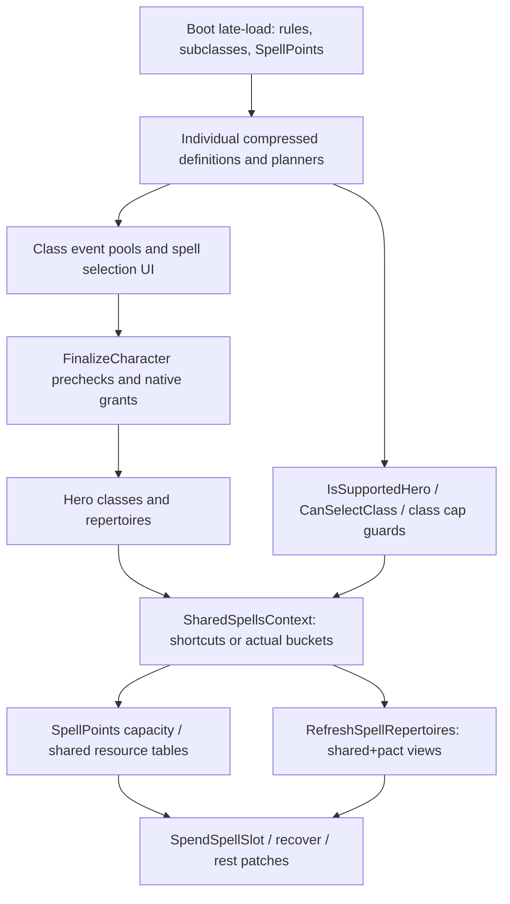
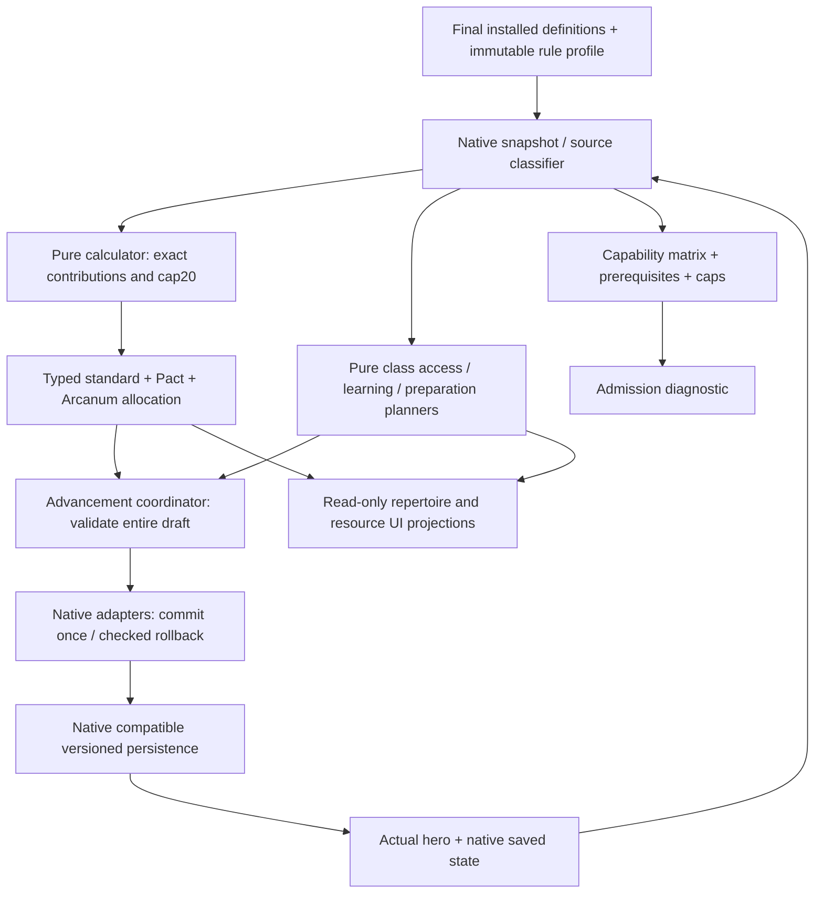

# Stage 13.1 — аудит и план интеграции multicaster

Дата: 2026-11-12. Репозиторий `rork2025-beep/SolastaUnfinishedBusiness`, ветка `feature/progression-20-to-12`. Аудируемый runtime: **cdbe3e84aa3e64cfbd99606c11f06c504d8c7d58** (Stage12).

**Результат этого этапа — проект реализации, не включённая поддержка mixed casting.** Runtime, определения классов, настройки и существующие guards не изменены. Следующие этапы ниже являются предложенной последовательностью работ; их выполнение и снятие ограничений в Stage13.1 не производятся.

## 1. Проверенный baseline и границы доказательств

Повторно выполнено в существующем checkout `/workspace/SolastaUnfinishedBusiness`:

```bash
export PATH="/workspace/.dotnet:$PATH"
export DOTNET_ROOT=/workspace/.dotnet DOTNET_CLI_HOME=/workspace/.setup-solasta/dotnet-home
export NUGET_PACKAGES=/workspace/.setup-solasta/nuget DOTNET_CLI_TELEMETRY_OPTOUT=1
export SolastaInstallDir=/workspace/SolastaUnfinishedBusiness/SolastaFiles
dotnet --list-sdks
dotnet build SolastaUnfinishedBusiness.sln --no-restore -c "Release Workflow" -m:2
dotnet run --project Tests/FighterProgression/FighterProgression.Tests.csproj
git diff --check
```

Фактически: **SDK9.0.320; 6209 checks passed; Build succeeded, 0 warnings, 0 errors**. Заявленные Stage12 цифры подтверждены. Исходных failures нет. Переустановка зависимостей не потребовалась. Исходное состояние tracked files чистое; неотслеживаемая `SolastaFiles/Mods/` уже существовала и содержит локальные build artifacts.

6209 — существующие автономные проверки production planners/transactions на managed doubles и проверки blueprint/Cecil/source metadata. Это не 6209 игровых сценариев. Дополнительно прочитаны IL/metadata установленного `Assembly-CSharp.dll` через Cecil для Mystic Arcanum и rest/cast/serialization путей; DLL не исполнялась и в Git не добавлялась. Ни новый калькулятор, ни предлагаемые acceptance tests ниже на этом этапе не реализованы. Игра, Harmony hooks, GUI, save/load, инвентарь и бой не запускались.

## 2. Карта фактических production-путей

Пути в таблицах указаны относительно `SolastaUnfinishedBusiness/`, если не оговорено иное. Имена относятся к аудируемому commit, а не к предполагаемым tabletop правилам.

| Файл | Ключевые методы/типы | Фактическое назначение |
|---|---|---|
| `Models/BootContext.cs` | `LateLoad` | Сначала Multiclass/Spells/SharedSpells, затем 2014/2024, Subclasses, Inventor SSI, SpellPoints; затем Fighter→…→Inventor progression contexts. GUI recache выполняется после них |
| `Models/SharedSpellsContext.cs` | `ClassCasterType`, `SubclassCasterType`, `GetCasterTypeForClassOrSubclass` | Registry стандартных Full/Half/HalfRoundUp и четырёх OneThird subclasses; Warlock не входит в стандартный registry |
| тот же | `IsMulticaster` | Считает **репертуары** с origin != Race, а не уникальные классы. Monster не исключён этим конкретным предикатом |
| тот же | `GetSharedCasterLevel`, `CasterLevelContext.IncrementCasterLevel/GetCasterLevel` | Short-circuit single compressed casters; иначе суммирование **реальных** уровней по caster-type buckets. Сам accumulator не ограничивает результат20 |
| тот же | `GetSharedSpellLevel`, `LateLoad`, `MaxSpellLevelOfSpellCastingLevel`, `SharedSpellsTranspiler` | Resource ceiling по таблицам1–20; временный флаг обхода getter patch для получения class-local ceiling. Флаг статический, без try/finally |
| тот же | `GetWarlockCasterLevel/GetWarlockSpellLevel/GetWarlockMaxSlots/GetWarlockUsedSlots/GetWarlockSpellRepertoire`, `FactorMysticArcanum` | Независимые Pact capacity/circle и sentinel `PactMagicSlotsTab=-1`; отдельная поправка видимости Arcanum |
| `Builders/Features/FeatureDefinitionCastSpellBuilder.cs` | `EnumerateSlotsPerLevel`, `SlotsByCasterLevel`, `CasterProgression` | Исходные resource tables, включая solo Half/OneThird округление и `forceOnes` для SP |
| `Models/SpellPointsContext.cs` | `LateLoad`, `SwitchFeatureDefinitionCastSpellSlots`, `FeatureDefinitionCastSpellTab` | Подменяет class/subclass slot rows; Warlock исключён из списка замен. При start-at1 у Paladin/Ranger выбираются HalfRoundUp rows |
| тот же | `ModifyPowerPoolAmountPowerSpellPoints.GetCasterLevel/PoolChangeAmount`, `SpellPointsByLevel` | Размер PowerSpellPoints, индексы0–20; compressed single overrides, mixed SharedSpells fallback, затем character-level-based single fallback |
| тот же | `PowerSpellPoints`, `GrantPowerSpellPoints`, `IsSpellPointsEnabled`, `GetMaxSpellPoints/GetRemainingSpellPoints/AddSpellPoints` | Один power pool героя, LongRest; grant хранится под ActiveFeatures[TagRace], что **не делает его расовым casting repertoire**; AddSpellPoints ограничивает максимум |
| тот же | `ConsumeSlotsAtLevelsPointsCannotCastAnymore`, `ConvertAdditionalSlotsIntoSpellPointsBeforeRefreshSpellRepertoire` | Расход SP и slot-view flags; условные дополнительные ячейки конвертируются в SP с удалением condition. В conversion используется прямое `remainingUses +=`, в отличие от capped AddSpellPoints |
| `Patches/RulesetCharacterPatcher.cs` | `RefreshSpellRepertoires_Patch.Prefix/Postfix` | Конвертация condition slots; сбор additional affinities; смешанные shared+pact capacities копируются в Class/Subclass repertoires |
| `Patches/RulesetSpellRepertoirePatcher.cs` | `SpendSpellSlot_Patch.SpendSpellSlot/SpendMulticasterWarlockSlots/SpendWarlockSlots/ConsumeSlot` | Race/Monster расходуются отдельно; стандартные mixed counters зеркалируются; SP списываются один раз через флаг consume; Pact selection зависит от repertoire, Shift и AlwaysSpendPactSlotsFirst |
| тот же | `MaxSpellLevelOfSpellCastingLevel_Getter_Patch`, `CanUpcastSpell_Patch`, `GetLowestAvailableSlotLevel_Patch` | Подменяет resource ceiling на max(shared,pact); это не допустимый уровень изучения каждого класса |
| тот же | `RecoverMissingSlots_Patch`, `HasMissingSpellSlots_Patch` | Recovery распространяет dictionary по репертуарам; predicate missing slots учитывает потраченные SP |
| `Patches/RulesetCharacterPatcher.cs` | `RecoverMissingSlots_Patch.Prefix`, `ApplyRest_Patch.Transpiler/RestoreAllSpellSlots` | В recovery добавляет SP; rest adapter отдельно восстанавливает Pact-составляющую при mixed short rest, full restore на long rest |
| `Patches/SlotRecoveryModalPatcher.cs` | `ShowSlotRecovery_Patch.Prefix`, `Refresh_Patch.BindX` | SP recovery UI сводится к выбору level1 и стоимости; не отдельный универсальный recovery engine |
| `CustomUI/MulticlassGameUi.cs` | `RebuildSlotsTable`, `PaintPactSlots`, `PaintPactSlotsAlternate`, `AddAvailableSubLevels` | Отображение merged resources и выбора круга/pact; источник ресурса частично выводится из контекста |
| тот же | `SpellsByLevelGroupBindLearning`, `GetCurrentPool`, `FilterMulticlassBleeding`, `CollectAllAutoPreparedSpells` | Переключение между class event pools, extended lists/auto spells; class learning hooks вызываются по очереди |
| `Patches/CharacterReactionItemPatcher.cs` | `GetSelectedSubItem_Patch`, `SetupSpellPoints` | Выбор активного subitem, стоимость SP в реакции; необходимо согласование с выбранным resource owner |
| `Api/Helpers/LevelUpHelper.cs` | `RegisterHero`, `SetSelectedClass/GetSelectedClass`, `GetAllowedSpells/GetAllowedAutoPreparedSpells/GetOtherClassesKnownSpells`, `EnumerateKnownAndAcquiredSpells` | Реальный класс текущего повышения, class-local caches; EnableRelearnSpells/DisplayAllKnownSpellsDuringLevelUp влияют на межклассовые дубли |
| тот же | `GetClassForSubclass`, `GetMaxAutoPrepSpellsLevel`, `GrantCustomFeatures`, `GrantCustomFeaturesFromFeats` | Восстановление owner класса, bonus spells, custom/feat grants; feat может создать repertoire с null class/subclass/race |
| `Api/GameExtensions/RulesetSpellRepertoireExtensions.cs` | `GetCaster`, `GetCastingClass` | Owner через BearerGuid (fallback Global.InspectedHero), ClassHolder и Druid owner resolver. Нельзя полагаться на inspected hero при команде/сериализации |
| `Api/Helpers/MulticlassInOutRulesHelper.cs` | `EnumerateHeroAllowedClassDefinitions`, `ApproveMultiClassInOut`, `MyGetAttribute`, `GetItemsAttributeModifiers` | Проверяет выход из текущего класса, поддерживаемость, MaxAllowedClasses, входные характеристики; затем все compressed cap/caster guards. Учитывает базовые/additive значения с исключением соответствующих предметных прибавок |
| `Patches/RulesetCharacterHeroPatcher.cs` | `CanLevelUp_Getter_Patch`, `AddClassLevel_Patch.Prefix`, `ComputeMaxPreparedSpells_Patch` | Реальный total cap/история; независимая граница class selection; 2024 preparation tables |
| `Patches/CharacterBuildingManagerPatcher.cs` | `AssignClassLevel_Patch.Prefix`, `FinalizeCharacter_Patch.Prefix/Postfix`, `TrainInvocation_Patch`, `UnlearnInvocation_Patch` | Повторный cap/caster guard; последовательная prevalidation; затем native/custom mutation; custom invocations обходят native Warlock point-pool accounting |
| `Models/ToolsContext.cs` | `FunctorRespec.Execute`, активный `FinalizeRespec`, `TransferConditionsOfCategory`, `CleanupOldHeroConditions`, `DropInventoryOnFloor/DropItem` | Новый герой, termination старых effects, GUID swap/condition transfer, inventory handling. Первый вариант FinalizeRespec под `#if false` не является действующим |
| `Patches/RulesetCharacterPatcher.cs` | `SerializeElements_Patch.Postfix`, `SetupFromSubstituteCharacter_Patch` | Deserialization power attribute fix и перенос remainingUses из формы |
| `Patches/RulesetActorPatcher.cs` | `SerializeElements_Patch.Transpiler` | Поддержка custom serialized RulesetCondition types |
| `Patches/GameSerializationManagerPatcher.cs` | `Refresh_Patch`, `RefreshAsync_Patch` | Только SaveByLocation/load-button state; это не готовый serializer multicaster ledger |

### 2.1 Все индивидуальные casting adapters

| Файл | Что уже есть и что нужно сохранить |
|---|---|
| `Models/WizardSpellcastingContext.cs` | `Initialize`, `ConfigureLearning`, `TryGetLearningMaximum`, `LearningBoundaryPatch`, `GrantLearningPatch`, `PreparedPatch`; scribing events, реальные spellbooks/pages/OwnerName. IsSupportedHero/CanSelectClass — более ранний и более узкий registry-based вариант |
| `Models/SorcererSpellcastingContext.cs` | `Initialize`, `Events`, `KnownBefore`, `ConfigureLearning`, `FilterSelection`, Acquire/Unlearn/Undo/Clear/Grant patches, `ValidateLearningPatch`, `SingleCasterLevel`; отдельные learning/replacement события |
| `Models/WarlockSpellcastingContext.cs` | Те же известные/заменяемые spells и UI events, но `PactSpellLevel` максимум5; Initialize проверяет ShortRest и native Pact rows. `ValidateLearningPatch` вызывает также `WarlockInvocationContext.CanAccept` |
| `Models/BardSpellcastingContext.cs` | `Initialize`, `Events`, `ConfigureLearning`, Collect/Build steps, Acquire/Unlearn/Clear/Grant и IsSupportedHero/CanSelectClass; вместе с partial-файлом ниже |
| `Models/BardMagicalSecretsContext.cs` | partial **BardSpellcastingContext**: `RegisterSecrets/RegisterSecretTag`, `Choices`, `Initial/Apply/Before`, `Allowed/InClassLists`, `ValidateAll`, `BeginFinalize`. Secrets хранятся отдельно от обычных known spells |
| `Models/ClericSpellcastingContext.cs` | WholeList/Prepared; `Initialize`, `AdaptAutoPrepared`, `PreparedPatch`, `BeginFinalize`, per-level/origin grant ledger; настоящая WIS и 2024 table |
| `Models/DruidSpellcastingContext.cs` | Аналогичный WholeList/Prepared, WIS/circle lists; `BeginFinalize`; связан с `DruidWildshapeContext.SpellPointOwner/IsSupportedWildShape/FormCastingLevelPatch` |
| `Models/PaladinSpellcastingContext.cs` | WholeList/Prepared, `CaptureRules`, `SingleCasterLevel`, `PreparedPatch`, `BeginFinalize`; Half/HalfRoundUp, обычная подготовка CHA+floor(original/2), независимо от resource rounding |
| `Models/RangerSpellcastingContext.cs` | Selection/AllKnown, `Initialize` отвергает внешнюю WholeList замену; захватывает final known/replacement tables и original maximum circles, `ConfigureLearning`, `Events`; 2024 flag не превращает автоматически Ranger в prepared caster |
| `Models/RangerSpellLearningContext.cs` | partial RangerSpellcastingContext: `Allowed`, `Initial/Apply/Before`, `ValidateAll`, `BeginFinalize`; production `RangerSpellLearningState<T>`, порядок исходных learn/replace и legacy invocation validation |
| `Models/InventorSpellcastingContext.cs` | WholeList/Prepared/INT/HalfRoundUp, `Initialize`, `PreparedPatch`, `BeginFinalize`, `SlotsRefreshPatch`; не wizard spellbook и не known-spell кастер |
| `Models/FighterProgressionContext.cs` | Сжатие только Fighter/Champion/WeaponMaster; `LateLoad` удаляет из runtime subclass choice остальные Fighter subclasses, включая third casters |
| `Models/RogueProgressionContext.cs` | Сжимает class/subclass features, но прямо сообщает, что ShadowCaster/ArcaneScoundrel casting tables, shared caster level и SP **не сжаты** |

Cleric/Druid legacy preparation = max(1, own effective level + real WIS + affinity bonuses); Paladin/Inventor = max(1, floor(own effective level/2) + real CHA/INT + bonuses). Wizard добавляет effective−actual к native legacy result. Общая 2024-таблица `ComputeMaxPreparedSpells_Patch` содержит **Cleric, Druid, Paladin, Wizard**, не Inventor/Ranger/Bard/Sorcerer. Значения и affinities необходимо читать из финальных definitions; названия флагов не заменяют эту проверку.

Существующие `IsSupportedHero` обычно требуют одновременно: не IsMulticaster, отсутствие чужого non-Race casting feature, отсутствие второго casting class/subclass. `CanSelectClass` поздних adapters также избегает класса, у которого все доступные subclasses кастующие; Wizard проверяет registry более узко. Есть отдельные AssignSubclass/feat guards. Изменение только одного helper не разрешает безопасный mixed build.

### 2.2 Транзакции и порядок финализации

- `Models/FighterProgressionPlan.cs`: stable original event mapping `[1,2,3,4,5,7,9,11,13,15,17,20]`, `FighterProgressionInitialization` — session latch, включая OFF.
- `Models/SpellcastingProgressionPlan.cs`: `OriginalLevels`, `ProjectRows/ProjectCumulative`, `PrimaryScribedEvents`, `CanFitSpellbooks`. Projected definition уже индексируется **реальным** уровнем: повторно передавать effective в неё нельзя.
- `Models/KnownSpellsProgressionPlan.cs`: `Events`, `Learned`, `CompressedReplacements`, `ApplyEvent`, `OrderSteps`; budget и chronological removals/additions. Один итоговый cumulative total не заменяет отдельные события.
- `Models/BardSpellLearningState.cs`: `LearnOrdinary/LearnSecrets/LearnCantrips`, `Ordered`; отдельные Origins и защита от дублей в пределах Bard. `Models/RangerSpellLearningState.cs`: production immutable Apply с бюджетами и allowed predicate.
- `Models/WarlockInvocationContext.cs` + `Models/WarlockInvocationTransactionsContext.cs`: `Configure`, `Transaction`, `BeforeChange`, `ValidateComplete`, `CanAccept`, `BeginFinalize`, `ApplyOrPass`, `FinalizationPatch.Transpiler/Finalizer`. `Models/WarlockInvocationTransaction.cs`: `Replay/Before/Prepare/ApplyPrepared/InvalidatedBy`. Проверяются original prerequisites, snapshot/rollback, grant-collision и repeated finalization. Некоторые immediate/choice-grant retraining/reacquisition намеренно отклоняются; это не готовый universal hero rollback.
- `Models/InventorInfusionPlan.cs`, `Models/InventorInfusionContext.cs`: отдельные custom Infusion pools/Origins, используют тот же pure transaction journal, но собственный custom UI и фильтры. `TryApply` вызывается из Warlock ApplyOrPass **до** его собственного branch. Нельзя считать все custom invocations Pact Magic.
- Фактический `FinalizeCharacter_Patch.Prefix`: Warlock invocation BeginFinalize → Bard → Cleric → Druid → Paladin → Ranger → Inventor spells/infusions, затем GrantRaceFeatures/feat/custom grants и native finalizer. **Wizard, Sorcerer и Warlock spell learning не имеют здесь аналогичного общего BeginFinalize**: у ранних adapters значительная часть проверки остаётся в acquisition/UI. Для mixed mode нужна единая server-side prevalidation перед любыми grants, даже при обходе UI.

### 2.3 Warlock: установленный механизм

Warlock не Full caster для SharedSpellsContext. Pact circle/capacity рассчитываются из own Warlock actual/effective level; на original20 — четыре слота круга5 с ShortRest recharge. Таблица `SharedSpellsContext.WarlockCastingSlots` — вспомогательное представление Pact capacity на нескольких кругах; это отличается от проверяемой WarlockSpellcastingContext native definition с одним ненулевым кругом. Не складывать каждую ненулевую ячейку вспомогательной строки как отдельный ресурс.

Mystic Arcanum: официальные PointPoolWarlockMysticArcanum6/7/8 на original11/13/15, UB `Level20Context.WarlockLoad` добавляет9 на17; compressed actual8/9/10/11. Это Spell pools с точным min=max circle и ExtraSpellsTag=`MysticArcanum`. Установленная native DLL содержит:

- `RulesetSpellRepertoire.IsMysticArcanumSpell`, `SpendMysticArcanum(int)`, `IsMysticArcanumAvailable(int)`, `RestoreAllMysticArcanum`, `SerializeElements`;
- выборы в `extraSpellsByTag["MysticArcanum"]`, расход в **usedMysticArcanum[circle]**, отдельно от usedSpellsSlots;
- `RulesetCharacter.CastSpell` направляет Arcanum в SpendMysticArcanum вместо обычного SpendSpellSlot;
- `RulesetCharacter.ApplyRest` отдельно вызывает RestoreAllMysticArcanum на LongRest; обычный repertoire.RestoreAllSpellSlots очищает usedSpellsSlots, не этот dictionary.

Это подтверждено чтением IL/metadata, не выполнением боя/rest. Arcanum не даёт вклад в shared caster level, SP, стандартные slots6–9 или Pact circle6–9.

`WarlockProgressionContext.RecoverPactSlots` пока поддерживает только single caster: очищает native positive-circle counter, а не mixed sentinel−1. `SharedSpellsContext.RecoverySlots` различает Wizard Arcane Recovery, Land Natural Recovery, Warlock Eldritch Master и SpellMaster Bonus Recovery. `Level20Context.PowerWarlockEldritchMaster` клонирует recovery power; legacy/2024 параметры должны оставаться source-driven. Просто ослабить IsSupportedHero здесь опасно.

### 2.4 Racial, feat и bonus spell access

Origin enum не является полной схемой владения. `Feats/CasterFeats.cs.MakeSpellFeatureAndInvocations`, некоторые `RaceFeats/OtherFeats` создают **Race-origin** casting features для feat spells; потому не всякий Race-origin repertoire означает биологическую расу. `LevelUpHelper.GrantCustomFeaturesFromFeats` может вызвать GrantSpellRepertoire с null class/subclass/race. `RulesetSpellRepertoirePatcher.FormatTitle` специально обрабатывает такие случаи.

Auto-prepared/extended-list grants, Magical Secrets и invocation extra spells часто добавляются к существующему repertoire и **не создают дополнительного casting class**. Native `ComputeAutopreparedSpells_Patch` проверяет SpellcastingClass либо `RepertoireValidForAutoPreparedFeature`, затем class-local GetSpellcastingLevel. `GetClassForSubclass` ищет top-level subclass choice и требует отдельного внимания при wrapped definitions.

Bard legacy Secrets сохраняют отдельные CantripOrSpell pools и ExtraSpellsByTag; 2024 `Tabletop2024Context.SwitchBardBardMagicalSecrets` расширяет доступ через Cleric/Druid/Wizard lists. `BardMagicalSecretsContext.InClassLists` включает соответствующие affinities с original10. Ни чужой список, ни общая высокая ячейка не меняет Bard learning budget. Общие hero.FeaturesToBrowse affinity sums после допуска нескольких классов необходимо проверить на двойной учёт AdditionalKnown/AdditionalScribed/Prepared bonuses.

## 3. Обнаруженные архитектурные риски

1. **Single/mixed разные пути.** Single compressed shortcuts возвращают собственный caster level только при IsSupportedHero. Mixed guards выключают их; разрешение mixed без нового calculator незаметно вернёт actual levels. Wizard отсутствует среди shortcuts GetSharedCasterLevel, хотя имеет отдельный compressed override в SpellPoints.GetCasterLevel. Его shared UI ceiling и SP budget могут идти разными путями.
2. **Fallback через CharacterLevel.** Некомпрессированный single casting class + martial может получить SP по общему уровню персонажа; например Wizard8/Fighter12 попадает на Full=character20, а не own Wizard8. Это source-level discrepancy, не утверждение об исполненном игровом сценарии. Новая модель должна использовать class-local contribution; OFF остаётся на baseline, исправление только в явно включённом новом режиме.
3. **Rounding сгруппирован.** Legacy mixed округляет суммы типов, не каждый класс. Две нечётные Half или OneThird могут давать другой результат. Warlock создаёт mixed context при нулевом стандартном вкладе.
4. **Raw sum >20.** Сейчас вызовы `FullCastingSlots[S−1]`, `SpellPointsFullCastingSlots[S−1]`, `SpellPointsByLevel[S]` сами не ограничивают S. После сжатия raw31 возможен при actual20; без clamp будет выход за таблицы. Существующие guards предотвращают поддерживаемый доступ к таким compressed mixed сценариям.
5. **Один getter, две задачи.** MaxSpellLevel getter смешивает class access и shared/pact upcast availability; helper со статическим bypass-флагом используется в разных UI/native местах. Ошибка контекста открывает чужие learning circles либо скрывает законный upcast. Нужны разные explicit queries.
6. **Зеркалируемые dictionary не отдельные pools.** Повторный debit/refund/recovery на каждом repertoire удвоит расход/восстановление. Recovery loop сейчас посещает даже больше origins, чем refresh/spend filters; projection должна иметь явный список views.
7. **SP flags неоднозначны.** ConsumeSlots… ставит positive slot flags при нехватке SP и отдельно при cast circle>5. Нельзя из одного usedSpellsSlots после save/load надёжно вывести, это affordability-view или исчерпанное high-circle использование. High-circle ограничения надо сохранять по installed semantics, включая upcast, а не считать Arcanum.
8. **Additional slots неоднородны.** ChitinousBoon affinity — Pact-specific. Temporary condition conversion может поднять remaining SP выше табличного max прямым +=, тогда как AddSpellPoints capped. Не терять bonus resources без явной policy и не переводить постоянную affinity в повторяемые бесплатные SP на каждом Refresh.
9. **Подготовка/affinity bleed.** FeaturesToBrowse scratch-list и некоторые суммы global; class-specific bonuses, list access, duplicate-spell policy и EnableRelearnSpells нельзя объединить в одну глобальную коллекцию known/prepared spells.
10. **Ранние adapters и third casters.** Fighter prototype исключает caster subclasses; Rogue magic оставлена несжатой. Нельзя автоматически назначить OneThird contribution effective20 только потому, что feature progression compressed. Wizard/Sorcerer/Warlock spell finalization требует усиления до снятия guards.
11. **CWT не сохранение.** Selection/grant/action journals временные. Новый расход/версия режима не может жить только в ConditionalWeakTable. Load/clone/shape/respec меняют ссылки и GUID ownership.
12. **Не только spell actions.** Sorcerer conversion, Paladin Smite/recharge, Ranger free Mark, Druid recovery/form и Inventor SSI расходуют связанные ресурсы через разные пути. Native child CastNoCost может наследовать parent UsablePower; повторно списывать parent нельзя.

## 4. Предлагаемая чистая модель

### 4.1 Раздельные величины

| Значение | Определение |
|---|---|
| ActualCharacterLevel | Сумма реальных class levels/ClassesHistory; ≤20, источник HP/PB и соответствующих character-level правил |
| ActualClassLevel | Число реальных уровней конкретного класса; compressed cap12, обычный cap по текущим правилам |
| EffectiveFeatureLevel | M(actual) только для включённого и поддержанного class feature adapter, иначе actual |
| EffectiveCastingLevel | Отдельное значение: M(actual) **только при наличии подтверждённого casting adapter**, иначе actual; не автоматически равно EffectiveFeatureLevel |
| ClassCasterContribution | Точное e/1, e/2 либо e/3 и rounding bucket, плюс eligibility; Pact/auxiliary/None дают0. Не округлять каждый Half отдельно |
| RawSharedCasterLevel | Итог применения выбранного solo/mixed правила к buckets; сохраняется для отчёта и диагностики насыщения |
| SharedCasterLevel | clamp(RawSharedCasterLevel,0,20); используется только для standard resource row/SP base budget |
| ClassSpellAccess | Собственная original-event/class row, list, knowledge/readiness, ability и rule variant; не SharedCasterLevel |
| Learning/Preparation | Независимые class/repertoire/event budgets, cantrips, scribing, prepared table, auto spells, bonus origins |
| StandardResource | Одна authoritative shared slot **либо** SP base allocation, отдельно дополнительные feature credits/slots |
| PactResource | Own Warlock e → source Pact row/circle/short-rest spent; исключён из standard budget |
| OtherResources | Arcanum per-circle, Sorcery Points, Channel Divinity, Wild Shape, free Mark, infusions, stored-item charges и т.п. со своими owners/recharge |

Никакого изменения реального GetClassLevel, истории, HP, PB, INT/WIS/CHA, уровней Summon вне адресного source-owner adapter. Class access должен индексировать либо сохранённые **original** tables по e/event, либо **projected** tables по actual, но никогда projected tables по e.

### 4.2 Округление: установленная семантика и явная policy

Все формулы ниже используют **EffectiveCastingLevel e**, не character total. Для несжатого кастера e=actual. Условие начала колдовства определяется финальным definition/unlock, в том числе start-at1 flags.

| Тип | Установленный solo table/SP path | Установленный grouped multiclass contribution |
|---|---|---|
| Full | e | sum(eFull) |
| Half | 0 до открытия spellcasting; затем ceil(e/2), не tabletop floor | floor(sum(eHalf)/2) |
| HalfRoundUp | ceil(e/2), доступен с1 | ceil(sum(eHalfRoundUp)/2) |
| OneThird | 0 до открытия subclass casting, затем ceil(e/3) | floor(sum(eThird)/3) |
| Pact / None / auxiliary racial-feat | Standard contribution0 | Standard contribution0 |

**Решение:** сохранить оба режима округления, с явным `RoundingMode`. Solo — один уникальный участвующий casting class; mixed — два или три, **включая Pact Warlock в число участников**, хотя вклад Warlock в стандартную сумму0. Иначе Warlock1+Half Paladin3 получит ceil(3/2)=2 вместо установленного mixed floor=1. Racial/feat/bonus views число участников не увеличивают.

Для mixed:

```text
raw = sum(eFull)
    + floor(sum(eHalf)/2)
    + ceil(sum(eHalfRoundUp)/2)
    + floor(sum(eThird)/3)
shared = min(20, max(0, raw))
```

Например Half3+Half3 даёт3, не1+1=2; OneThird4+OneThird5 даёт3, не1+1=2. Buckets Half и HalfRoundUp нельзя объединять: используются разные rounding rules. Registry Paladin/Ranger меняется Switch…SpellCastingAtOne; с flags ON это HalfRoundUp.

Отдельная обнаруженная неоднозначность baseline: accumulator просматривает classes registry даже до фактического открытия их casting, а IsMulticaster смотрит уже существующие repertoires. **Предлагаемая новая policy** допускает contribution/участие только после зарегистрированного casting unlock (class/subclass start): Paladin1/Ranger1 с start-at2 не создают новый ресурс или phantom participant. Это осознанное отличие от отдельных raw-helper edge cases, а не утверждение об их текущем игровом поведении; обязательные golden tests13.2. При OFF такие edge cases не исправлять незаметно.

`CasterProgression.Flat` и фиксированные касты не получают коэффициент Full/Half автоматически: допускаются как auxiliary/innate только после классификации конкретного definition. Неизвестный кастующий источник без registry adapter → `UnsupportedSource` и сохранение guard, не None по умолчанию. Multiple casting features одного owner class не суммируются повторно. Auto-spells/Secrets расширяют доступ, а не вклад.

### 4.3 Сжатые и обычные классы; насыщение

Каждый class snapshot имеет независимые flags feature/casting compression и version/rule fingerprint. Disabled class использует исходный actual уровень, даже рядом с включённым compressed классом. У текущих Rogue third casters eCasting остаётся actual; у compressed Fighter third subclasses вообще недоступны. План не включает неавторизованное добавление сжатой магии этим subclasses.

При raw>20 сохраняем полный trace contributions и выдаём `ResourceTableSaturated`, используем только row20 и SP[20]=133. Не суммируем SP разных классов, не выдаём второй pool133, circle10 или дополнительные epic slots. Class features/learning/preparation не обрезаются до остатка shared budget и не делятся между классами. Cap относится к **табличному базовому ресурсу**; независимо легитимные feature/item bonuses классифицируются отдельно, а не теряются при clamp.

Пример Wizard12 compressed + Cleric8 ordinary: raw20+8=28, shared20, base133 SP; Wizard access9, Cleric access4 и подготовка по Cleric8. Пример Wizard8 compressed + Sorcerer12 compressed: raw11+20=31, shared20; actual total20, собственные access6 и9.

### 4.4 Предлагаемые интерфейсы (спецификация, не готовый код)

```csharp
// Только immutable DTO, IDs и числа. Никаких Unity/Harmony/Main.Settings/ServiceRepository.
public enum ResourceDomain { Standard, Pact, Arcanum, Innate, Item, ClassPower }
public enum RoundingMode { InstalledSolo, UbGroupedMulticlass }
public enum SourceRole { StandardClass, PactClass, AttachedGrant, Innate, Item, Unsupported }

public record ClassCastingInput(
    string ClassId, string SubclassId, string CastingDefinitionId,
    int ActualLevel, int EffectiveFeatureLevel, int EffectiveCastingLevel,
    CasterKind Kind, bool CastingUnlocked, SourceRole Role, string ProfileVersion);
public record ExactContribution(string ClassId, int Numerator, int Denominator, CasterKind Bucket);
public record ContributionBucket(CasterKind Kind, int LevelSum, int RoundedValue);
public record SharedCastingResult(
    int ActualCharacterLevel, RoundingMode Mode,
    IReadOnlyList<ExactContribution> Classes, IReadOnlyList<ContributionBucket> Buckets,
    int RawLevel, int ResourceLevel, bool Saturated, IReadOnlyList<Diagnostic> Diagnostics);

public interface ISharedCasterCalculator {
    SharedCastingResult Calculate(CastingSnapshot input, InstalledResourceTables tables);
}
public interface IClassSpellAccessPlanner {
    ClassSpellAccess Access(CastingSnapshot input, RepertoireKey owner, int originalEvent);
    PreparationPlan Preparation(CastingSnapshot input, RepertoireKey owner);
    IReadOnlyList<LearningEvent> Advancement(CastingSnapshot input, ClassLevelChange change);
}
public interface IResourcePlanner {
    ResourceAllocation Allocate(CastingSnapshot input, SharedCastingResult shared);
    ResourceTransition Spend(ResourceState before, SpendRequest request);
    ResourceTransition Recover(ResourceState before, RecoveryRequest request);
}
public interface IAdvancementPlanner {
    ValidatedAdvancement Prepare(CastingSnapshot before, AdvancementDraft draft);
}
```

`CasterKind`, Snapshot, tables, requests и diagnostics должны быть определены как DTO в13.2. Native adapter лишь снимает source/rule snapshot, классифицирует feature origins и передаёт immutable данные. Предлагаемое имя opt-in настройки — `EnableCompressedMulticasterPrototype` (OFF по умолчанию); в Stage13.1 такое поле не добавлено. Новый resource engine применяется только при этом флаге, валидном profile marker и подтверждённой capability; OFF всегда сохраняет старый путь. Admission читает capability matrix, а не вызывает старый SingleCasterLevel. Calculator не вызывает IsSupportedHero (иначе mixed станет0 либо возникнет цикл). `UnsupportedSource`, `AmbiguousOwner`, `IncompatibleProfile`, `IncompleteEvent`, `ResourceExhausted`, `ClassCapDeadlock` — структурированные результаты, не пустые списки без объяснения.

Resource tables передаются из финального installed registry, включая slot zero/sentinel conventions, own-class access rows, SP costs `[0,2,3,5,6,7,9,10,11,13]`, SP base0…133 и Pact rows. Input validation отвергает невалидные actual levels/history/caps; clamp применяется к resource total, не маскирует Inventor13 или повреждённый snapshot.

## 5. Владение ресурсами и сохранением

`HeroId` — native GUID. `RepertoireKey` включает casting-definition ID, class/subclass/racial/feat source и native repertoire identity; отдельный `GrantOriginId` хранит исходный event/pool. Несколько grants могут принадлежать одному repertoire: не создавать второй repertoire ради нового origin. Contribution dedup — по casting owner class, не по количеству features или native views.

| Ресурс/состояние | Authoritative owner | Представление / правила |
|---|---|---|
| Shared slots | Hero + Standard + profile | Один spent counter по circle; native Class/Subclass capacities/used dictionaries — только согласованные views |
| Shared SP | Hero.PowerSpellPoints + profile | Один base remaining/debit; affordability flags производные; high-circle use flags отдельны. Родительское действие и child spell не платят дважды |
| Feature additional slots/SP | Grant/effect GUID + domain | ChitinousBoon → Pact; другие grants по подтверждённой source policy. Temporary conversion idempotent по condition/grant token; normal capped recovery отдельно от допустимого bonus credit |
| Pact | Hero + Warlock casting ID | Own circle/capacity и short-rest spent. Native−1 и positive views — проекции, не несколько budgets |
| Mystic Arcanum | Warlock repertoire + circle/grant | ExtraSpellsByTag + usedMysticArcanum. LongRest, не SP recovery и не Pact refill |
| Known/cantrips/prepared/auto spells | RepertoireKey + GrantOriginId | Никакого глобального union, который теряет способность, список, ownership или право замены |
| Wizard book | Native book item GUID + OwnerName + Wizard repertoire | Native страниц/доступных книг и costs. Не переписывать владельца, не создавать книгу/скроллы в calculator |
| Secrets / invocation grants | Bard/Warlock repertoire + original origin | Могут обращаться к чужим lists; resource contribution не создают |
| Sorcery/Channel/WildShape/free Mark/infusions/SSI | Их существующий class/power/item owner | Не нормализуются в shared casting level; расходы/конверсия идут через typed ResourceTransition |

Slot mode и SP mode выбирают единственное primary standard representation. На refresh не суммировать capacity каждого класса и не восстанавливать spent. При изменении max в level-up нужна явная политика сохранения потраченного количества; сначала зафиксировать native baseline, затем тестировать переход, а не выдавать полный refill каждым Refresh. Resource transition должен иметь ActionId/RestId, expected version, выбранные Domain/Owner/Circle и отдельные validate/commit, обеспечивающие ровно один расход/возврат на действие.

Pact/spell source независимы: spell, известный Wizard, может пользоваться допустимым Pact resource согласно installed UB selection policy. Это не делает его Warlock known spell и не меняет INT на CHA. Arcanum, racial free cast, invocation free cast, free Mark и stored-item activation должны проходить по своему явному domain до standard debit; `SpendRequest` не должен угадывать domain только по spell circle или non-null inherited UsablePower.

Для versioned resource state недостаточно CWT. Native сериализует repertoire usedSpellsSlots/usedMysticArcanum и usable powers, но неоднозначные SP flags и profile fingerprint требуют подтверждённого carrier. Кандидат — существующий pattern custom serialized RulesetCondition (`RulesetActorPatcher.SerializeElements_Patch`, пример `Subclasses/Builders/EldritchVersatility.cs.SerializeElements`); Stage13.7 обязан проверить lifecycle/round-trip и возможность прочитать неизвестную версию. Это **ещё не выбранная и не реализованная новая схема save**. При отсутствии безопасного carrier admission остаётся закрытым. Не добавлять непроверенные поля в native serializer и не объявлять GameSerializationManagerPatcher готовым решением.

Только новые тестовые mixed heroes/saves, полный restart при profile change. Не мигрировать старые saves автоматически и не восстанавливать ambiguous counters по эвристике. Load с несовпадающей версией/режимом или противоречивыми mirror dictionaries → diagnostic/refusal до расхода/level-up; не молчаливый refill. Druid form использует owner hero pool и rebinding после load, не второй state; исправить также monster branch SpellPoints.PoolChangeAmount, который сейчас берёт только Druid.SingleCasterLevel.

## 6. Граф зависимостей и точки интеграции

Текущий путь:



Предлагаемое направление зависимости (без цикла calculator↔admission):



Конкретные будущие изменения:

1. Snapshot registry после финальных source switches, но **до** destructive compression projection: конкретная точка Boot — после SpellPointsContext.LateLoad, перед FighterProgressionContext.LateLoad. Альтернатива — хранить original rows в каждом class adapter при Initialize. Второй проход ProjectRows по уже compressed rows недопустим. Resource baseline tables остаются uncompressed; class access может использовать original snapshot или actual-index projected rows.
2. GetSharedCasterLevel и private SpellPoints.GetCasterLevel должны делегировать одному результату calculator **только для разрешённого нового режима**. Legacy OFF paths не менять. Все table-index потребители получают bounded result, в том числе reaction/upcast UI.
3. RefreshSpellRepertoires строит domain-specific views из owner ledger. Spend/Recover/ApplyRest обрабатывают typed domain ровно один раз; native positive/−1 encoding не становится источником истины для двух бюджетов. Проверить дополнительные consumers в `SorcererProgressionContext` conversion, `PaladinPowerSafetyContext`, `2024DruidContext`, `RangerMarkContext`, `InventorItemSafetyContext`, SlotRecoveryModal и CharacterReactionItem.
4. Shared resource ceiling отделить от class access query в learning, HasKnowledgeOfSpell, EnumerateUsableSpells, ritual UI, ItemMenuModal, campaigns inspection. Последние consumers зарегистрированы SharedSpellsTranspiler: глобальная замена этого getter без audit каждого call site запрещена.
5. Class event UI получает явный RepertoireKey+EventId. Порядок `(owner, actual change, original, phase, stable origin)`; внутри продвигаемого класса chronological events, ordinary learning/secrets/invocation child pools не смешиваются. Остальные class panels — read-only, пока их class level не меняется. Race/feat events обрабатываются своим owner.
6. Единый coordinator вызывает validation **всех затронутых owners**, включая pending feat/subclass/granted repertoires, до GrantRaceFeatures/GrantCustomFeatures/native finalizer. Изолированные guards не должны независимо получить взаимоисключающие решения. Wizard book capacity и ownership проверяются и в finalization, не только в GUI.
7. `Prepare` строит immutable draft/snapshots до mutation; `Commit` применяет original events один раз. Warlock/Infusion journals остаются отдельными adapters. На сбое rollback только явно охваченной поверхности; если native grants/inventory нельзя откатить, операция запрещается заранее либо помечается poisoned с Cancel/reload. Не обещать общий inventory rollback.
8. Последним шагом заменить только mixed-caster rejection на capability-aware admission в EnumerateHeroAllowedClassDefinitions, AssignClassLevel, AddClassLevel, BeginLevelUp, AssignSubclass/feat guards, individual IsSupportedHero/action safety/finalizers. Class caps, total20, MaxAllowedClasses=3, реальные prerequisites, session/restart, старые-save guards и item/companion guards сохраняются.

## 7. Матрица совместимости и численные примеры

Это **целевая матрица**, не текущая поддержка. Сегодня mixed с compressed caster блокируется. `C` — подтверждённый compressed casting adapter; `N` — обычный actual casting; `H` — Half/start-at2, `HU` — HalfRoundUp/start-at1. Examples предполагают допустимые характеристики/классы и total≤20.

| Комбинация | Пример / ожидаемый расчёт нового режима | Классовые ограничения и условие допуска |
|---|---|---|
| Full C + Full C | Wizard12+Sorcerer8: e20+11=raw31 →20, 133 base SP | Own access9/6; один shared pool, два learning owners |
| Full C + Full N | Wizard12+Cleric8:20+8→20 | Cleric access4/prepare8, не effective11; не пересжимать обычный класс |
| Full N + Full N | Wizard5+Cleric5:raw10,64 SP | Обычные class access3/3, если новый режим явно включён; OFF baseline unchanged |
| Full + Half H | Wizard6 C+Paladin6 C:7+floor(7/2)=10,64 SP | Own circles4/2; общая ячейка5 только для допустимого upcast |
| Full + HU | Wizard6 C+Inventor6 C:7+ceil(7/2)=11,73 SP | Own circles4/2; реальный INT/preparation Inventor сохранён |
| Half H + Half H | Paladin6 C+Ranger6 C:floor((7+7)/2)=7,38 SP | Оба имеют own circle2; не учить circle4 из общего бюджета |
| Half/HU + Half/HU | Half3+Half3 →3; Half3+HU3 →1+2=3; HU3+HU3 →ceil(6/2)=3 | Тестировать все flags и нечётные buckets, не round по каждому классу |
| Warlock C + Full C | Warlock12+Wizard8: Pact e20=4×circle5; standard e11=73 SP | Arcanum6–9 отдельно; Wizard own access6; Shift/preference не меняет spell ability |
| Warlock + Half H | Warlock1 N+Paladin3 N: standard floor(3/2)=1,4 SP + Pact1×circle1 | Mixed rounding, несмотря на один standard class. Paladin может иметь own circle1 |
| Warlock + HU | Warlock12 C+Inventor8 C: standard ceil(11/2)=6,32 SP + Pact4×5 | Inventor own circle3; infusions/SSI отдельно |
| Full + OneThird N | Wizard6 C+Spellblade6 N:7+floor(6/3)=9,57 SP | Fighter compression OFF; собственная third-caster магия actual6 |
| OneThird N + OneThird N | Spellblade4+ShadowCaster5:floor(9/3)=3,14 SP | Собственные доступ/known/preparation не берутся из shared3 |
| Rogue feature C + OneThird | Rogue8 C ShadowCaster: eFeature11, eCasting8 | Никакого автоматического eCasting11/20; отдельная проверка existing magic adapter |
| Fighter feature C + caster subclass | Spellblade/SpellShield | **Остаётся недоступно**: текущий Fighter prototype допускает только Champion/WeaponMaster; план не снимает этот guard |
| Три casting classes | Wizard8 C+Cleric6 C+Sorcerer6 C:11+7+7=25→20 | Три независимых spell owners/abilities, один standard budget133 |
| Full + Half + Pact | Wizard6 C+Paladin6 C H+Warlock8 C:raw7+3=10 | Pact e11=3×5 отдельно; actual total20, third class cap сохранён |
| Один caster + martial | Wizard8 N+Fighter12 N:new-mode own caster8,44 SP | Не current fallback character20/133; explicit opt-in correction, OFF не меняется |
| Class + racial/feat spells | Wizard + native Race-origin Magic Initiate/innate casts | Вклад0, не меняет rounding mode; native free uses/ability/list и rest отдельно |
| Subclass auto-spells / Secrets | Cleric domain, Inventor Innovation, Bard Secrets | Attached grants, не второй caster; правильный owner/list/original event |
| Неизвестный Class/Subclass/feat repertoire | Origin без registry/ownership proof | Admission закрыт с UnsupportedSource/AmbiguousOwner до adapter, не молчаливый подсчёт |

Все примеры — acceptance expectations выбранной policy, а не исполненные mixed-game тесты.

## 8. План Stages 13.2–13.8 и обязательная приёмка

Каждый этап сохраняет runtime mixed guards закрытыми, пока capability не подтверждена последним rollout-этапом. Можно использовать shadow/read-only diagnostic adapters, но не включать частично готовую комбинацию для игрока. Production pure tests отделяются от Cecil binding checks и Unity tests.

### 13.2 — source registry, immutable snapshot и pure calculator

Deliverables: DTO/interface contracts из§4, profile/version snapshot, dedup classifier, exact contribution trace, solo/mixed rounding, bounded tables. Никаких мутаций героя или нового допуска классов.

Acceptance:

- **M02-01:** все20 original/12 actual mapping; отдельно feature/casting compressed flags, disabled/unsupported level13; actual history/HP/PB/abilities не меняются.
- **M02-02:** Full1…20; Half2/3/7, HU1/3/7, Third3/4/7 solo; legacy bucket mixed rules, odd Half3+3=3 и Third4+5=3; порядок classes/repertoires не влияет.
- **M02-03:** Warlock1+Half3 standard1, Warlock1+HU3 standard2; Warlock alone standard0; racial/feat extra views не переводят solo в mixed.
- **M02-04:** start-at2 Paladin1/Ranger1 не участник до unlock; старт1 switches переводят в HU; class/subclass будущий casting и unknown source дают разные explicit результаты.
- **M02-05:** несколько auto-spells/features одного класса не увеличивают contribution. Class origin с null owner не угадывается по выбранному UI герою.
- **M02-06:** raw20/21/25/28/31 → bounded20, base133; raw0 не обращается к row−1, raw>20 — не к row21; четыре класса/actual total21 отвергаются до расчёта.
- **M02-07:** полный набор примеров§7 как golden tests; входные immutable snapshots/tables не изменились. OFF snapshot вызывает тот же legacy path.

### 13.3 — стандартные slots/Spell Points и recovery owner

Deliverables: read-only shadow сравнение GetSharedCasterLevel/SpellPoints private path; standard ResourceState/Transition; native view adapter под закрытым mode gate; explicit additional-grant и high-circle policy.

Acceptance:

- **M03-01:** Full/Full и Full/Half из§7: ровно один base pool; source20 full133, source20 half64; не сумма личных budgets и не character-total fallback.
- **M03-02:** slots/SP обе настройки; spend/refund/cancel/повтор callback из двух views меняют owner один раз, cantrip/free/ritual не списывает pool.
- **M03-03:** recovery двух репертуаров не удваивает AddSpellPoints; short rest не refills standard LongRest pool, long rest делает это один раз, rest simulation не мутирует state.
- **M03-04:** circles6–9/upcast, affordability flags, high-circle exhaustion, повторные refresh и recovery не создают лишних uses; поведение сверить с installed native convention, Arcanum не затрагивать.
- **M03-05:** temporary slot condition conversion один раз по effect token; capped recovery отдельно от допустимого бонуса сверхbase; ChitinousBoon не попадает в standard credits.
- **M03-06:** start-at1 HalfRoundUp с SP не подменяет корректный budget обычными многократными slots; повтор SwitchFeatureDefinitionCastSpellSlots не пересжимает rows и не refills resource.
- **M03-07:** Druid form→hero→form использует тот же authoritative standard pool, включая mixed capacity; native binding и реальный rest требуют Unity проверки перед admission.

### 13.4 — class access, известные/подготовленные spells и Wizard books

Deliverables: class-local access/preparation/learning planner adapters для всех девяти casting contexts; явный per-repertoire affinity/duplicate policy; Wizard finalization validation. Guards ещё закрыты.

Acceptance:

- **M04-01:** Wizard6 C+Paladin6 C H shared circle5, но Wizard orig6/7 choices ограничены circle3/4, Paladin own circle2; нет shared-circle learning leak.
- **M04-02:** multiclass advancement изменяет только продвигаемый class event inventory, остальные known/cantrips/prepared/auto-spells/abilities сохраняются.
- **M04-03:** known/replacement sequence6/7 и18/19/20, замена раннего same-advancement выбора, Skip/Back/Cancel/Reset; без дублей/бесплатной замены, исходные origins не объединяются.
- **M04-04:** одинаковое spell definition в разных законных источниках не теряет owner. EnableRelearnSpells и DisplayAllKnownSpellsDuringLevelUp ON/OFF проверены; ранний global known filter не уничтожает законный class-local бюджет.
- **M04-05:** Cleric/Druid WIS, Wizard INT, Paladin CHA и Inventor INT: legacy и actual installed2024 tables по собственному уровню, affinity bonus применяется к правильным owners. Ranger остаётся Selection/AllKnown.
- **M04-06:** Wizard книги разных OwnerName/страниц, несколько books, недостаток страниц, initial equipment exception; перед native finalization повторная проверка fitting/ownership и явный отказ без создания книг/потери страниц.
- **M04-07:** ordinary некомпрессированный casting рядом с compressed использует actual rows; auto-spells domain/circle/oath/Innovation и prepared rituals не bleed в другой repertoire.

### 13.5 — Bard Secrets, third-caster adapters и auxiliary grants

Deliverables: совместимость Secrets с class-local learning; разрешённая **обычная** third-caster магия/несжатая Rogue magic; registry adapters для конкретных racial/feat/fighting-style/invocation grants. Не добавлять сжатие third-caster spell progression и не открывать неподдержанные Fighter subclasses.

Acceptance:

- **M05-01:** ordinary Bard известные отдельно от legacy Secrets; Lore/другие реальные secret pools, original10/14/18 →actual8/10/12 и соответствующие subclass события; полный count и независимые origins.
- **M05-02:** 2024 extended Cleric/Druid/Wizard lists начинают действовать на original10, остаются Bard casting, не получают второй repertoire/contribution или чужую preparation ability.
- **M05-03:** Secrets и обычная replacement в одном advancement не отменяют награды друг друга; same-definition policy, Back/Cancel, финальная проверка коллекций и ExtraSpellsByTag.
- **M05-04:** четыре зарегистрированных OneThird subclasses в ordinary mode; mixed floor buckets и solo ceil, максимум/known по их source tables. Rogue feature compression не повышает eCasting; compressed Fighter caster selection остаётся запрещённым.
- **M05-05:** native Race-origin feats, null-owner Class feats, Blessed/Druidic Warrior и Tome-like auxiliary features: каждая зарегистрирована явно; законные innate/free uses и собственная ability, без нового shared contribution/ложного multicaster.
- **M05-06:** unfamiliar grant fail-closed, без пустого level-up; pending feat casting распознаётся до GrantCustomFeaturesFromFeats, не после мутации героя.

### 13.6 — независимые Pact Magic, Arcanum и конверсии

Deliverables: typed Pact owner/views, explicit resource-source selection и домены Arcanum/recovery/conversion; сохраняются invocation transactions и их conservative restrictions.

Acceptance:

- **M06-01:** Warlock12 C+Wizard8 C: standard73 SP + Pact4×5 + отдельные Arcanum6/7/8/9; Warlock12+Inventor8:standard32 SP, не133/не extra Pact pool.
- **M06-02:** выбор Pact/standard через normal action/реакцию/upcast/Shift/AlwaysSpendPactSlotsFirst, включая exhaustion/fallback. Exactly-once debit, собственная spellcasting ability неизменна. Warlock alone с нулём standard SP сохраняет доступные Pact uses и правильную подпись UI, не ложный отказ из-за0 SP.
- **M06-03:** ShortRest/Eldritch Master восстанавливает Pact, не standard SP/Arcanum; LongRest — по доменам; обычный Arcane/Natural Recovery не refills Pact или Arcanum бесплатно.
- **M06-04:** Arcanum exact circles и usedMysticArcanum, CastSpell native branch; не требует standard slot6–9 и не списывает SP, не заменяет обычный known budget; repeated cast/Cancel/rest/save/load отдельно.
- **M06-05:** Invocation choice pools/known-spell prerequisites на original18/19/20, Pact/Tome 2024 и custom Eldritch Surge; нет коллизии с Inventor Infusion transaction. Existing immediate-grant/reacquisition guards остаются до доказанного rollback.
- **M06-06:** Sorcery↔slot/SP conversion, Smite, slot-recharge powers, free Hunter's Mark, Druid recovery, SSI/item charges: выбранный исходный domain тратится/возвращается один раз. Тестировать нативную политику Pact conversion, не предполагать запрет/разрешение из tabletop.

### 13.7 — общий UI/finalization coordinator, respec и persistence

Deliverables: class/event ownership UI, единая Prepare→Commit граница, versioned resource-state carrier после serialization spike, owner rebinding и conservative respec guards. До полного round-trip admission закрыт.

Acceptance:

- **M07-01:** pending class/subclass/feat/race/invocation/Secrets events проходят все validations до native grants; прямой вызов finalize с неполным Wizard/Sorcerer/Warlock draft отвергается так же, как UI.
- **M07-02:** repeated Init/CollectTags/BuildSteps/Finalize не дублируют события/пулы. Cancel/Back/Reset invalidates dependent originals; grant ledgers привязаны к фактическому advancement, а не только reusable data object.
- **M07-03:** fault injection на каждом owned mutation step; rollback заявленного surface, отсутствие resource refill; native inventory/immediate grant вне rollback → отказ до mutation либо poisoned Cancel/reload, без повторного commit.
- **M07-04:** versioned serialized state: 0/partially spent/full slots, SP affordability+high-circle flags, Pact sentinel/positive views и Arcanum survive round-trip. CWT очистить перед load; owner восстанавливается из сохранения. Unknown version/ambiguous mirrors отвергаются до cast.
- **M07-05:** Druid transformation/reversion/deserialization, respec GUID swap и смена canonical native view не копируют ресурс. Sources/conditions не указывают на уничтоженного героя.
- **M07-06:** respec и Cancel с known/Secrets/Arcanum/invocations/Spell Points/books/attuned items/infusions/SSI/summons; существующие Druid/Paladin/Ranger/Inventor cleanup guards сохранены. Никакой автоматической миграции или глобального inventory rollback.
- **M07-07:** actual Unity GUI/reaction/rest/save/load evidence отдельно от managed tests/Cecil. Проверить активный ToolsContext.FinalizeRespec, который drops inventory и превращает spellbook contents в scrolls по source коду; не тестировать только неиспользуемый #if false вариант.

### 13.8 — capability admission, opt-in rollout и полный regression gate

Deliverables: opt-in new mixed-mode setting в существующем UI, OFF default, restart/new-test-saves, ограниченная разрешённая matrix; единогласное решение всех selection/action/finalization guards. Только здесь можно открывать конкретные прошедшие комбинации.

Acceptance:

- **M08-01:** вся матрица§7 в разрешённых режимах обоих orders вступления в классы; 2/3 classes, compressed/ordinary ON/OFF per class; unsigned/unsupported комбинации остаются закрыты с причиной.
- **M08-02:** реальные STR/DEX/INT/WIS/CHA prerequisites, выход из текущего класса, class12/total20/max3, HP/PB/history неизменны. На capped классе без законной альтернативы ясный ClassCapDeadlock, не пустой экран/скрытый bypass.
- **M08-03:** OFF сохраняет baseline outputs/guards; смена mode/profile требует restart. Старый mixed/unmarked save не конвертируется автоматически; отсутствующий/несовместимый carrier блокирует допуск.
- **M08-04:** все6209 baseline checks плюс production suites13.2–13.7; отдельно counts behavioral/metadata/native-game. Release Workflow без ошибок, diff check, никаких DLL/settings/saves в commit.
- **M08-05:** отдельные Unity тестовые герои Full/Full, Full/Half, Half/Half, Warlock/Full, Warlock/Half, third и three-class; long/short rest, recovery, реакции, respec, reload после расхода и отмены. Непрошедшая runtime строка не получает capability=true.
- **M08-06:** Ranger Mark/companions/spell learning, Paladin Smite/recharge, Druid Wild Shape/owner pool, Cleric Channel Divinity, Bard Secrets, Warlock transactions, Inventor infusions/SSI/constructs и martial regressions сохранены. Не признавать combat/save success по compilation.

## 9. Критерий готовности и итог Stage13.1

Архитектурный blueprint готов к реализации pure model в13.2. **Mixed runtime сейчас не готов и не включён.** Основные gates: class/repertoire ownership, grouped rounding, cap20 во всех consumers, ровно один ресурсный debit/recovery, class-local spell events, pre-finalization для всех кастеров и доказанный save-state round-trip. Ни один существующий safety guard этим audit commit не ослабляется.

В Stage13.1 изменяется только этот документ. Не создавались worktree, release merge, mod package или новые runtime patches; source/settings/save/game assemblies не менялись. Commit и push документа — только в `feature/progression-20-to-12`.
